# Run profile — mosh-dqw

```
Profile: mosh-dqw · 1 invocation · 2026-10-24T06:51Z → 2026-10-24T09:50Z · wall 2h59m (task graph 2h41m, after the last landing 18m) · agents 91 (timed 91) · beads dispatched 11, landed 11, planned 11
Profile: graph scope — observed invocation/residual graph; historical topology is unknown
Profile: shape — 11 beads · 24 edges · depth 5 · width 2.2 · beads per level 3/3/3/1/1 · widest fan-out mosh-dqw.1 (5 direct, 8 transitive dependents)
Profile: bound — graph lower bound 2h41m along mosh-dqw.4 → mosh-dqw.8 → mosh-dqw.9 → mosh-dqw.11 (unlimited slots and merge lanes) · model of the run 2h41m (cap 14, one merge lane) vs actual 2h41m (100%) → graph-bound: the 4-bead dependency chain set the pace — reshaping it is the lever
Profile: critical path — 2h41m = implement 2h07m · review 29s · merge 41s · planning 33m · ready 5s · startup 19s · dispatch 18s
Profile: diagnosis — planning 33m (20% of first dispatch to last landing)
Profile: critical chain — close-epics ready 5s → plan planning 10m → plan-rest planning 23m → mosh-dqw.4 implement 9m → mosh-dqw.8 implement 19m → mosh-dqw.9 implement 1h27m → mosh-dqw.11 implement+review+merge 13m
Profile: bottleneck — mosh-dqw.9 — 1h27m on the critical path (54%) · implement 1h27m · dispatch 2s · implement on the path 1h27m: test 46m · poll 13m · build 43s · git 2s · read 30s · shell 8m · model 19m (longest: "cat >> tests/mosh_resume.rs <<'EOF'" 9m, "python3 - <<'EOF'" 9m) · dependents 1
Profile: waits — ready→start, summed per bead (beads wait at the same time, so not wall time): 0s over 0 of 11 landed beads
Profile: early unblock — 8 landed beads had in-run blockers · stacked on an implementation 5 · bounced on a stack conflict then waited for the merge 0 (0s) · waited for a merge without one 0
Profile: tests — implementers and fixers, summed: 1h07m running tests and 18m polling background runs, 51% of their 2h47m · 0 Bash call(s) ran into the 10-minute tool limit
Profile: slow tests — cargo test --locked --test mosh_resume -- slow_live_leg --nocapture 20m (4 runs, longest 9m) · cargo test --locked --test mosh_fallback 5m (5 runs, longest 2m) · cargo test --locked --test mosh_resume -- ring_overflow --nocapture 4m (2 runs, longest 3m) · cargo test --locked --test mosh_multi_client -- explore_saved --nocapture 3m (8 runs, longest 1m) · cargo test --locked --test mosh_fallback -- keeper_is keeper_exits concurrent stale 3m (1 run, longest 3m)
Profile: merge lane — busy 8m of 2h26m (6%) · seam reviews and fixes 0s (0% of busy) · 11 merge dispatches, first try not merged for 0 of 11 · queue wait 24s total, peak 1 waiting · stack-parent wait 0s
Profile: runtime — peak 8 agents at once of 16 runtime slots · full 0% of the run · slot cap 14
Profile: concurrency scope — all-agent concurrency peak 8 · task-slot concurrency peak 4, cap 14 (ordinary chains retain a slot through merge)
Profile: what-if estimate — faster mosh-dqw.9 → 1h58m (−44m, 27%) — its implement time halved; first dispatch to last landing, planning retained
Profile: what-if estimate — cut mosh-dqw.11 <- mosh-dqw.9 → 2h30m (−12m, 7%) — payoff if this edge were cut — whether it can be is a design call; first dispatch to last landing, planning retained
Profile: what-if estimate — split mosh-dqw.9 → 2h30m (−12m, 7%) — its 1 dependent(s) wait only for a contract slice ≈30% of its implement time; first dispatch to last landing, planning retained
Profile: what-if estimate — cut mosh-dqw.9 <- mosh-dqw.8 → 2h30m (−11m, 7%) — payoff if this edge were cut — whether it can be is a design call; first dispatch to last landing, planning retained
Profile: what-if estimate — split mosh-dqw.8 → 2h30m (−11m, 7%) — its 2 dependent(s) wait only for a contract slice ≈30% of its implement time; first dispatch to last landing, planning retained
Profile: what-if estimate — faster mosh-dqw.8 → 2h31m (−10m, 6%) — its implement time halved; first dispatch to last landing, planning retained
Profile: context — agents 92 (measured 92) · peak≥80% 0 · compacted 0 agents, 0 compactions · coordinator 599K/1000K (60%), 0 compactions · max coordinator 60%
Profile: context agent — coordinator peak 599K/1000K (60%) · first 164K · compactions 0
Profile: unmeasured — Claude context windows from the model table: claude-opus-5-5 1000K, claude-sonnet-5-5 1000K
```

## Per bead

Offsets are from the run's first dispatch. `wait` starts at evidenced creation/mapping/dependency availability, bounded by invocation start; unknown readiness means unknown wait. Creation, mapping and dependency timestamps stay distinct in JSON. `stack` waits for parents to merge; `queue` waits for the single merge lane; `lane` is its lane turn (merge plus seam work).

| bead | deps | dependents | attempts | wait (cause) | implement | of it: tools | review | fix | stack | queue | lane (seam) | landed | critical |
|---|---|---|---|---|---|---|---|---|---|---|---|---|---|
| mosh-dqw.1 | 0 | 5 | IMPLEMENTED | - | 5m | test 2m · build 1m · git 1s · read 10s · shell 3s | 24s | - | - | 6s | 47s | +17m |  |
| mosh-dqw.2 | 0 | 3 | IMPLEMENTED | - | 7m | test 3m · build 47s · read 6s · shell 2m | 25s | - | - | 2s | 47s | +19m |  |
| mosh-dqw.3 | 0 | 1 | IMPLEMENTED | - | 4m | poll 55s · build 36s · git 1s · shell 1m | 27s | - | - | 2s | 1m | +16m |  |
| mosh-dqw.4 | 1 | 4 | IMPLEMENTED | - | 9m | test 2m · build 2m · read 5s · shell 6s | 52s | - | - | 2s | 57s | +44m | 9m |
| mosh-dqw.5 | 2 | 2 | IMPLEMENTED | - | 3m | test 1m · build 43s · read 4s · shell 4s | 23s | - | - | 2s | 38s | +37m |  |
| mosh-dqw.6 | 1 | 2 | IMPLEMENTED | - | 7m | test 3m · build 1m · git 1s · read 4s · shell 4s | 58s | - | - | 2s | 44s | +42m |  |
| mosh-dqw.10 | 2 | 2 | IMPLEMENTED | - | 5m | test 2m · build 1m · git 1s · bd 1s · read 12s · shell 8s | 1m | 20s | - | 2s | 44s | +50m |  |
| mosh-dqw.7 | 1 | 2 | IMPLEMENTED | - | 8m | test 3m · read 5s · shell 8s | 55s | - | - | 2s | 33s | +52m |  |
| mosh-dqw.8 | 4 | 2 | IMPLEMENTED | - | 19m | test 4m · poll 2m · build 1m · git 3s · read 11s · shell 14s | 54s | - | - | 2s | 37s | +1h03m | 19m |
| mosh-dqw.9 | 3 | 1 | IMPLEMENTED | - | 1h27m | test 46m · poll 13m · build 43s · git 2s · read 30s · shell 8m | 45s | - | - | 2s | 37s | +2h30m | 1h27m |
| mosh-dqw.11 | 10 | 0 | IMPLEMENTED | - | 12m | test 2m · poll 2m · build 3m · git 3s · read 14s · shell 15s | 29s | - | - | 2s | 41s | +2h41m | 13m |

## Critical path, step by step

| at | step | kind | via | duration |
|---|---|---|---|---|
| +0s | run start | startup |  | 19s |
| +19s | close-epics | ready |  | 5s |
| +24s | previous → plan | dispatch |  | 2s |
| +26s | plan | planning | previous | 10m |
| +10m | previous → plan-rest | dispatch |  | 3s |
| +10m | plan-rest | planning | previous | 23m |
| +33m | planned → impl:mosh-dqw.4 | dispatch |  | 2s |
| +33m | impl:mosh-dqw.4 | implement | planned | 9m |
| +42m | dep → impl:mosh-dqw.8 | dispatch |  | 2s |
| +42m | impl:mosh-dqw.8 | implement | dep | 19m |
| +1h01m | dep → impl:mosh-dqw.9 | dispatch |  | 2s |
| +1h01m | impl:mosh-dqw.9 | implement | dep | 1h27m |
| +2h28m | dep → impl:mosh-dqw.11 | dispatch |  | 3s |
| +2h28m | impl:mosh-dqw.11 | implement | dep | 12m |
| +2h40m | chain → review:mosh-dqw.11 | dispatch |  | 2s |
| +2h40m | review:mosh-dqw.11 | review | chain | 29s |
| +2h41m | chain → merge:mosh-dqw.11 | dispatch |  | 2s |
| +2h41m | merge:mosh-dqw.11 | merge | chain | 41s |

## Longest tool calls in the bottleneck's implement (mosh-dqw.9)

| tool | category | what | duration |
|---|---|---|---|
| Bash | test | cat >> tests/mosh_resume.rs <<'EOF' | 9m |
| Bash | test | python3 - <<'EOF' | 9m |
| Bash | poll | for i in $(seq 55) | 9m |
| Bash | shell | for mode in "MOSH_NO_RESUME=1 MOSH_PASTE_MIB=16" "MOSH_NO_T… | 5m |
| Bash | test | python3 - <<'EOF' | 3m |
| Bash | poll | for i in $(seq 55) | 3m |
| Bash | test | cat >> tests/mosh_resume.rs <<'EOF' | 3m |
| Bash | test | python3 - <<'EOF' | 2m |
| Bash | shell | python3 - <<'EOF' | 2m |
| Bash | test | for i in 1 2 3 | 2m |

## Schedule model

Landed beads replayed with their measured implement, review+fix and lane times; creation, mapping and invocation bounds retained, with dispatch as the conservative release when readiness is unknown. In-model dependencies release at their modeled implementation/merge times; known releases outside the model stay fixed. Window: first dispatch to last landing; planning retained. Model of the run: 2h41m against 2h41m measured. Estimates, not measurements.

| scenario | makespan | saving |
|---|---|---|
| as run (cap 14, one merge lane) | 2h41m | - |
| unlimited slots | 2h41m | 0s |
| unlimited merge lanes | 2h41m | 0s |
| graph lower bound (both) | 2h41m | 0s |
| faster mosh-dqw.9 | 1h58m | 44m |
| cut mosh-dqw.11 <- mosh-dqw.9 | 2h30m | 12m |
| split mosh-dqw.9 | 2h30m | 12m |
| cut mosh-dqw.9 <- mosh-dqw.8 | 2h30m | 11m |
| split mosh-dqw.8 | 2h30m | 11m |
| faster mosh-dqw.8 | 2h31m | 10m |
| cut mosh-dqw.8 <- mosh-dqw.4 | 2h39m | 2m |

## Timeline

each bead's final attempt; critical-path steps are marked crit.

```mermaid
gantt
  dateFormat x
  axisFormat %H:%M
  section mosh-dqw.1
  impl :1792825326588, 1792825638409
  review :1792825640232, 1792825664205
  merge :1792825670285, 1792825717460
  close-check :1792825719466, 1792825723730
  section mosh-dqw.2
  impl :1792825328112, 1792825755664
  review :1792825757515, 1792825782675
  merge :1792825784506, 1792825831308
  close-check :1792825832976, 1792825836634
  section mosh-dqw.3
  impl :1792825328113, 1792825568979
  review :1792825570936, 1792825597600
  merge :1792825599326, 1792825661893
  close-check :1792825663918, 1792825668630
  section mosh-dqw.4
  impl :crit, 1792826687652, 1792827221270
  review :1792827223276, 1792827275009
  review-bead :1792827223277, 1792827229389
  merge :1792827276954, 1792827333679
  close-check :1792827335381, 1792827340002
  section mosh-dqw.5
  impl :1792826689120, 1792826865904
  review :1792826867707, 1792826890493
  review-bead :1792826867708, 1792826873974
  merge :1792826892490, 1792826930460
  close-check :1792826932353, 1792826936684
  section mosh-dqw.6
  impl :1792826689120, 1792827109053
  review :1792827110934, 1792827168890
  review-bead :1792827110935, 1792827137445
  merge :1792827170670, 1792827214493
  close-check :1792827216286, 1792827220561
  section mosh-dqw.10
  impl :1792827223278, 1792827552354
  review :1792827554256, 1792827617354
  review-bead :1792827554257, 1792827561615
  fix :1792827619080, 1792827639307
  merge :1792827640962, 1792827684585
  close-check :1792827686742, 1792827691209
  section mosh-dqw.7
  impl :1792827223278, 1792827713184
  review-bead :1792827715170, 1792827722057
  review :1792827715170, 1792827770519
  merge :1792827772239, 1792827804868
  close-check :1792827806526, 1792827810896
  section mosh-dqw.8
  impl :crit, 1792827223278, 1792828377574
  review :1792828379696, 1792828433488
  review-bead :1792828379697, 1792828387860
  merge :1792828435216, 1792828472682
  close-check :1792828474600, 1792828479820
  section mosh-dqw.9
  impl :crit, 1792828379698, 1792833599918
  review :1792833602700, 1792833647269
  review-bead :1792833602701, 1792833609214
  merge :1792833649208, 1792833686638
  close-check :1792833688481, 1792833693879
  section mosh-dqw.11
  impl :crit, 1792833602702, 1792834308075
  review :crit, 1792834310077, 1792834338887
  merge :crit, 1792834340620, 1792834381206
  close-check :1792834382983, 1792834386853
```



## Context

- Profile: context — agents 92 (measured 92) · peak≥80% 0 · compacted 0 agents, 0 compactions · coordinator 599K/1000K (60%), 0 compactions · max coordinator 60%
- Profile: context agent — coordinator peak 599K/1000K (60%) · first 164K · compactions 0

| agent | role | model | tasks | requests | first | peak | window | source | peak% | compactions |
| --- | --- | --- | --- | --- | --- | --- | --- | --- | --- | --- |
| coordinator | coordinator | claude-opus-5-5 | 8 | 149 | 164K | 599K | 1000K | table | 60% | 0 |
| impl:mosh-dqw.9 | agent | claude-sonnet-5-5 | 1 | 111 | 39K | 341K | 1000K | table | 34% | 0 |
| plan-rest | agent | claude-opus-5-5 | 1 | 59 | 34K | 285K | 1000K | table | 28% | 0 |
| impl:mosh-dqw.8 | agent | claude-sonnet-5-5 | 1 | 45 | 39K | 219K | 1000K | table | 22% | 0 |
| final-review:cluster:6 | agent | claude-opus-5-5 | 1 | 37 | 35K | 197K | 1000K | table | 20% | 0 |
| final-review:cluster:7 | agent | claude-opus-5-5 | 1 | 42 | 35K | 166K | 1000K | table | 17% | 0 |
| plan | agent | claude-opus-5-5 | 1 | 50 | 34K | 163K | 1000K | table | 16% | 0 |
| final-review:cluster:8 | agent | claude-opus-5-5 | 1 | 36 | 35K | 143K | 1000K | table | 14% | 0 |
| impl:mosh-dqw.7 | agent | claude-sonnet-5-5 | 1 | 20 | 39K | 136K | 1000K | table | 14% | 0 |
| final-review:cluster:2 | agent | claude-opus-5-5 | 1 | 19 | 35K | 125K | 1000K | table | 13% | 0 |
| impl:mosh-dqw.11 | agent | claude-sonnet-5-5 | 1 | 41 | 40K | 134K | 1000K | table | 13% | 0 |
| impl:mosh-dqw.4 | agent | claude-sonnet-5-5 | 1 | 13 | 38K | 120K | 1000K | table | 12% | 0 |
| final-review:cluster:4 | agent | claude-opus-5-5 | 1 | 18 | 35K | 106K | 1000K | table | 11% | 0 |
| final-review:cluster:5 | agent | claude-opus-5-5 | 1 | 32 | 35K | 111K | 1000K | table | 11% | 0 |
| final-review:seam | agent | claude-opus-5-5 | 1 | 25 | 35K | 112K | 1000K | table | 11% | 0 |
| impl:mosh-dqw.10 | agent | claude-sonnet-5-5 | 1 | 24 | 39K | 108K | 1000K | table | 11% | 0 |
| impl:mosh-dqw.6 | agent | claude-sonnet-5-5 | 1 | 17 | 38K | 108K | 1000K | table | 11% | 0 |
| final-review:cluster:1 | agent | claude-opus-5-5 | 1 | 11 | 35K | 87K | 1000K | table | 9% | 0 |
| impl:mosh-dqw.1 | agent | claude-sonnet-5-5 | 1 | 17 | 38K | 95K | 1000K | table | 9% | 0 |
| review:mosh-dqw.8 | agent | claude-sonnet-5-5 | 1 | 10 | 35K | 85K | 1000K | table | 9% | 0 |
| edge-audit:1 | agent | claude-opus-5-5 | 1 | 6 | 34K | 78K | 1000K | table | 8% | 0 |
| impl:mosh-dqw.2 | agent | claude-sonnet-5-5 | 1 | 19 | 38K | 84K | 1000K | table | 8% | 0 |
| impl:mosh-dqw.3 | agent | claude-sonnet-5-5 | 1 | 19 | 38K | 78K | 1000K | table | 8% | 0 |
| review:mosh-dqw.10 | agent | claude-sonnet-5-5 | 1 | 10 | 35K | 77K | 1000K | table | 8% | 0 |
| assemble:final | agent | claude-sonnet-5-5 | 1 | 12 | 35K | 65K | 1000K | table | 7% | 0 |
| final-review:cluster:3 | agent | claude-opus-5-5 | 1 | 13 | 35K | 74K | 1000K | table | 7% | 0 |
| impl:mosh-dqw.5 | agent | claude-sonnet-5-5 | 1 | 8 | 38K | 68K | 1000K | table | 7% | 0 |
| review:mosh-dqw.4 | agent | claude-sonnet-5-5 | 1 | 6 | 35K | 73K | 1000K | table | 7% | 0 |
| review:mosh-dqw.6 | agent | claude-sonnet-5-5 | 1 | 8 | 35K | 71K | 1000K | table | 7% | 0 |
| review:mosh-dqw.7 | agent | claude-sonnet-5-5 | 1 | 8 | 35K | 75K | 1000K | table | 7% | 0 |
| review:mosh-dqw.1 | agent | claude-sonnet-5-5 | 1 | 4 | 35K | 59K | 1000K | table | 6% | 0 |
| review:mosh-dqw.11 | agent | claude-sonnet-5-5 | 1 | 5 | 36K | 57K | 1000K | table | 6% | 0 |
| review:mosh-dqw.9 | agent | claude-sonnet-5-5 | 1 | 8 | 35K | 58K | 1000K | table | 6% | 0 |
| fix:mosh-dqw.10 | agent | claude-sonnet-5-5 | 1 | 3 | 37K | 51K | 1000K | table | 5% | 0 |
| ledger-append:surface:2 | agent | claude-sonnet-5-5 | 1 | 2 | 33K | 45K | 1000K | table | 5% | 0 |
| merge:mosh-dqw.1 | agent | claude-sonnet-5-5 | 1 | 9 | 37K | 47K | 1000K | table | 5% | 0 |
| merge:mosh-dqw.10 | agent | claude-sonnet-5-5 | 1 | 9 | 37K | 49K | 1000K | table | 5% | 0 |
| merge:mosh-dqw.11 | agent | claude-sonnet-5-5 | 1 | 9 | 37K | 48K | 1000K | table | 5% | 0 |
| merge:mosh-dqw.2 | agent | claude-sonnet-5-5 | 1 | 8 | 37K | 48K | 1000K | table | 5% | 0 |
| merge:mosh-dqw.3 | agent | claude-sonnet-5-5 | 1 | 9 | 37K | 47K | 1000K | table | 5% | 0 |
| merge:mosh-dqw.4 | agent | claude-sonnet-5-5 | 1 | 9 | 37K | 48K | 1000K | table | 5% | 0 |
| merge:mosh-dqw.5 | agent | claude-sonnet-5-5 | 1 | 10 | 37K | 47K | 1000K | table | 5% | 0 |
| merge:mosh-dqw.6 | agent | claude-sonnet-5-5 | 1 | 9 | 37K | 47K | 1000K | table | 5% | 0 |
| merge:mosh-dqw.7 | agent | claude-sonnet-5-5 | 1 | 9 | 37K | 49K | 1000K | table | 5% | 0 |
| merge:mosh-dqw.8 | agent | claude-sonnet-5-5 | 1 | 9 | 37K | 48K | 1000K | table | 5% | 0 |
| merge:mosh-dqw.9 | agent | claude-sonnet-5-5 | 1 | 8 | 37K | 48K | 1000K | table | 5% | 0 |
| review:mosh-dqw.2 | agent | claude-sonnet-5-5 | 1 | 5 | 35K | 54K | 1000K | table | 5% | 0 |
| review:mosh-dqw.3 | agent | claude-sonnet-5-5 | 1 | 4 | 35K | 49K | 1000K | table | 5% | 0 |
| review:mosh-dqw.5 | agent | claude-sonnet-5-5 | 1 | 4 | 35K | 54K | 1000K | table | 5% | 0 |
| worktree-sweep | agent | claude-sonnet-5-5 | 1 | 3 | 34K | 46K | 1000K | table | 5% | 0 |
| ledger:mosh-dqw.10 | agent | claude-sonnet-5-5 | 1 | 2 | 34K | 37K | 1000K | table | 4% | 0 |
| ledger:mosh-dqw.11 | agent | claude-sonnet-5-5 | 1 | 2 | 34K | 37K | 1000K | table | 4% | 0 |
| ledger:mosh-dqw.2 | agent | claude-sonnet-5-5 | 1 | 2 | 33K | 40K | 1000K | table | 4% | 0 |
| ledger:mosh-dqw.3 | agent | claude-sonnet-5-5 | 1 | 2 | 32K | 37K | 1000K | table | 4% | 0 |
| ledger:mosh-dqw.6 | agent | claude-sonnet-5-5 | 1 | 2 | 33K | 36K | 1000K | table | 4% | 0 |
| ledger:mosh-dqw.7 | agent | claude-sonnet-5-5 | 1 | 2 | 33K | 35K | 1000K | table | 4% | 0 |
| ledger:mosh-dqw.9 | agent | claude-sonnet-5-5 | 1 | 2 | 33K | 35K | 1000K | table | 4% | 0 |
| read-ledger:finish | agent | claude-sonnet-5-5 | 1 | 3 | 34K | 42K | 1000K | table | 4% | 0 |
| bd-ready | agent | claude-sonnet-5-5 | 1 | 2 | 33K | 34K | 1000K | table | 3% | 0 |
| bd-ready | agent | claude-sonnet-5-5 | 1 | 2 | 33K | 34K | 1000K | table | 3% | 0 |
| close-check:mosh-dqw.1 | agent | claude-sonnet-5-5 | 1 | 2 | 32K | 33K | 1000K | table | 3% | 0 |
| close-check:mosh-dqw.10 | agent | claude-sonnet-5-5 | 1 | 2 | 32K | 33K | 1000K | table | 3% | 0 |
| close-check:mosh-dqw.11 | agent | claude-sonnet-5-5 | 1 | 2 | 32K | 33K | 1000K | table | 3% | 0 |
| close-check:mosh-dqw.2 | agent | claude-sonnet-5-5 | 1 | 2 | 32K | 33K | 1000K | table | 3% | 0 |
| close-check:mosh-dqw.3 | agent | claude-sonnet-5-5 | 1 | 2 | 32K | 33K | 1000K | table | 3% | 0 |
| close-check:mosh-dqw.4 | agent | claude-sonnet-5-5 | 1 | 2 | 32K | 33K | 1000K | table | 3% | 0 |
| close-check:mosh-dqw.5 | agent | claude-sonnet-5-5 | 1 | 2 | 32K | 33K | 1000K | table | 3% | 0 |
| close-check:mosh-dqw.6 | agent | claude-sonnet-5-5 | 1 | 2 | 32K | 33K | 1000K | table | 3% | 0 |
| close-check:mosh-dqw.7 | agent | claude-sonnet-5-5 | 1 | 2 | 32K | 33K | 1000K | table | 3% | 0 |
| close-check:mosh-dqw.8 | agent | claude-sonnet-5-5 | 1 | 2 | 32K | 33K | 1000K | table | 3% | 0 |
| close-check:mosh-dqw.9 | agent | claude-sonnet-5-5 | 1 | 2 | 32K | 33K | 1000K | table | 3% | 0 |
| close-epics | agent | claude-sonnet-5-5 | 1 | 2 | 33K | 34K | 1000K | table | 3% | 0 |
| close-epics | agent | claude-sonnet-5-5 | 1 | 2 | 33K | 34K | 1000K | table | 3% | 0 |
| ledger-append:detector | agent | claude-sonnet-5-5 | 1 | 2 | 32K | 34K | 1000K | table | 3% | 0 |
| ledger-append:edge-audit:1 | agent | claude-sonnet-5-5 | 1 | 2 | 33K | 34K | 1000K | table | 3% | 0 |
| ledger-append:launch | agent | claude-sonnet-5-5 | 1 | 2 | 33K | 35K | 1000K | table | 3% | 0 |
| ledger-append:metrics | agent | claude-sonnet-5-5 | 1 | 2 | 33K | 35K | 1000K | table | 3% | 0 |
| ledger-append:recovery:deferred:mosh-dqw:sweep:mosh-phase1-resumable-session-20261024T052906 | agent | claude-sonnet-5-5 | 1 | 2 | 33K | 34K | 1000K | table | 3% | 0 |
| ledger-append:surface:1 | agent | claude-sonnet-5-5 | 1 | 2 | 32K | 34K | 1000K | table | 3% | 0 |
| ledger-recurring:1 | agent | claude-sonnet-5-5 | 1 | 2 | 32K | 34K | 1000K | table | 3% | 0 |
| ledger:mosh-dqw.1 | agent | claude-sonnet-5-5 | 1 | 2 | 33K | 34K | 1000K | table | 3% | 0 |
| ledger:mosh-dqw.4 | agent | claude-sonnet-5-5 | 1 | 2 | 33K | 35K | 1000K | table | 3% | 0 |
| ledger:mosh-dqw.5 | agent | claude-sonnet-5-5 | 1 | 2 | 32K | 34K | 1000K | table | 3% | 0 |
| ledger:mosh-dqw.8 | agent | claude-sonnet-5-5 | 1 | 2 | 33K | 34K | 1000K | table | 3% | 0 |
| read-ledger | agent | claude-sonnet-5-5 | 1 | 2 | 33K | 35K | 1000K | table | 3% | 0 |
| review-bead:mosh-dqw.10 | agent | claude-sonnet-5-5 | 1 | 2 | 33K | 34K | 1000K | table | 3% | 0 |
| review-bead:mosh-dqw.4 | agent | claude-sonnet-5-5 | 1 | 2 | 33K | 34K | 1000K | table | 3% | 0 |
| review-bead:mosh-dqw.5 | agent | claude-sonnet-5-5 | 1 | 2 | 33K | 34K | 1000K | table | 3% | 0 |
| review-bead:mosh-dqw.6 | agent | claude-sonnet-5-5 | 1 | 2 | 33K | 34K | 1000K | table | 3% | 0 |
| review-bead:mosh-dqw.7 | agent | claude-sonnet-5-5 | 1 | 2 | 33K | 34K | 1000K | table | 3% | 0 |
| review-bead:mosh-dqw.8 | agent | claude-sonnet-5-5 | 1 | 2 | 33K | 34K | 1000K | table | 3% | 0 |
| review-bead:mosh-dqw.9 | agent | claude-sonnet-5-5 | 1 | 2 | 33K | 34K | 1000K | table | 3% | 0 |

## Unmeasured

- Claude context windows from the model table: claude-opus-5-5 1000K, claude-sonnet-5-5 1000K
