# Run profile — mosh-dqw

```
Profile: mosh-dqw · 1 invocation · 2026-10-24T10:24Z → 2026-10-24T11:17Z · wall 54m (task graph 43m, after the last landing 11m) · agents 46 (timed 46) · beads dispatched 5, landed 5, planned 16
Profile: graph scope — observed invocation/residual graph; historical topology is unknown
Profile: shape — 16 beads · 0 edges · depth 1 · width 16 · beads per level 16
Profile: bound — graph lower bound 43m (unlimited slots and merge lanes) · model of the run 43m (cap 14, one merge lane) vs actual 43m (100%) → bead-bound: mosh-dqw.19 alone set the pace — split it or make it faster
Profile: critical path — 43m = implement 30m · review 26s · merge 46s · planning 10m · ready 6s · startup 55s · dispatch 10s
Profile: diagnosis — planning 10m (24% of first dispatch to last landing)
Profile: critical chain — close-epics ready 6s → plan planning 10m → mosh-dqw.19 implement+review+merge 32m
Profile: bottleneck — mosh-dqw.19 — 32m on the critical path (74%) · implement 30m · review 26s · merge 46s · dispatch 8s · implement on the path 30m: test 7m · poll 19m · build 57s · read 16s · shell 5s · model 3m (longest: "for i in $(seq 55)" 2m, "for i in $(seq 23)" 2m) · dependents 0
Profile: waits — ready→start, summed per bead (beads wait at the same time, so not wall time): 0s over 0 of 5 landed beads
Profile: early unblock — 0 landed beads had in-run blockers · stacked on an implementation 0 · bounced on a stack conflict then waited for the merge 0 (0s) · waited for a merge without one 0
Profile: tests — implementers and fixers, summed: 24m running tests and 22m polling background runs, 81% of their 58m · 0 Bash call(s) ran into the 10-minute tool limit
Profile: slow tests — cargo test mosh:: 6m (3 runs, longest 4m) · cargo nextest run --locked -E 'test(mosh::) | binary(mosh_fallback) | binary(mosh_multi_c… 4m (2 runs, longest 2m) · cargo nextest run --locked -E 'test(mosh::remote::attacher) | test(mosh::local_bridge)' 2m (1 run, longest 2m) · cargo test --locked --test client_mode federated_client_starts_without_local_and_survives… 2m (2 runs, longest 2m) · cargo nextest run --locked -E 'binary(mosh_resume) | binary(mosh_multi_client) | binary(m… 2m (3 runs, longest 2m)
Profile: merge lane — busy 5m of 30m (16%) · seam reviews and fixes 1m (22% of busy) · 7 merge dispatches, first try not merged for 2 of 5 · queue wait 2m total, peak 1 waiting · stack-parent wait 0s
Profile: conflicts — src/mosh/local_bridge.rs (stack conflicts 0, seam overlaps 1, declared by 6) · src/mosh/remote/attacher.rs (stack conflicts 0, seam overlaps 1, declared by 5)
Profile: runtime — peak 7 agents at once of 16 runtime slots · full 0% of the run · slot cap 14
Profile: concurrency scope — all-agent concurrency peak 7 · task-slot concurrency peak 5, cap 14 (ordinary chains retain a slot through merge)
Profile: what-if estimate — faster mosh-dqw.19 → 28m (−15m, 35%) — its implement time halved; first dispatch to last landing, planning retained
Profile: context — agents 47 (measured 47) · peak≥80% 0 · compacted 0 agents, 0 compactions · coordinator 666K/1000K (67%), 0 compactions · max coordinator 67%
Profile: context agent — coordinator peak 666K/1000K (67%) · first 164K · compactions 0
Profile: unmeasured — Claude context windows from the model table: claude-opus-5-5 1000K, claude-sonnet-5-5 1000K
```

## Per bead

Offsets are from the run's first dispatch. `wait` starts at evidenced creation/mapping/dependency availability, bounded by invocation start; unknown readiness means unknown wait. Creation, mapping and dependency timestamps stay distinct in JSON. `stack` waits for parents to merge; `queue` waits for the single merge lane; `lane` is its lane turn (merge plus seam work).

| bead | deps | dependents | attempts | wait (cause) | implement | of it: tools | review | fix | stack | queue | lane (seam) | landed | critical |
|---|---|---|---|---|---|---|---|---|---|---|---|---|---|
| mosh-dqw.19 | 0 | 0 | IMPLEMENTED | - | 30m | test 7m · poll 19m · build 57s · read 16s · shell 5s | 26s | - | - | 2s | 46s | +43m | 32m |
| mosh-dqw.21 | 0 | 0 | IMPLEMENTED | - | 9m | test 6m · git 1s · read 2s · shell 1m | 27s | - | - | 46s | 1m (18s) | +22m |  |
| mosh-dqw.20 | 0 | 0 | IMPLEMENTED | - | 10m | test 8m · git 1s · read 2s · shell 12s | 22s | - | - | 1m | 2m (47s) | +24m |  |
| mosh-dqw.23 | 0 | 0 | IMPLEMENTED | - | 38s | git 3s · read 2s · shell 6s | 24s | - | - | 2s | 34s | +13m |  |
| mosh-dqw.22 | 0 | 0 | IMPLEMENTED | - | 9m | test 3m · poll 3m · git 1s · read 5s · shell 52s | 25s | - | - | 2s | 44s | +21m |  |

## Critical path, step by step

| at | step | kind | via | duration |
|---|---|---|---|---|
| +0s | run start | startup |  | 55s |
| +55s | close-epics | ready |  | 6s |
| +1m | previous → plan | dispatch |  | 2s |
| +1m | plan | planning | previous | 10m |
| +11m | planned → impl:mosh-dqw.19 | dispatch |  | 4s |
| +11m | impl:mosh-dqw.19 | implement | planned | 30m |
| +42m | chain → review:mosh-dqw.19 | dispatch |  | 2s |
| +42m | review:mosh-dqw.19 | review | chain | 26s |
| +42m | chain → merge:mosh-dqw.19 | dispatch |  | 2s |
| +42m | merge:mosh-dqw.19 | merge | chain | 46s |

## Longest tool calls in the bottleneck's implement (mosh-dqw.19)

| tool | category | what | duration |
|---|---|---|---|
| Bash | poll | for i in $(seq 55) | 2m |
| Bash | poll | for i in $(seq 23) | 2m |
| Bash | poll | for i in $(seq 22) | 2m |
| Bash | poll | for i in $(seq 22) | 2m |
| Bash | poll | for i in $(seq 22) | 2m |
| Bash | poll | for i in $(seq 20) | 2m |
| Bash | poll | for i in $(seq 20) | 2m |
| Bash | test | python3 - <<'E' | 2m |
| Bash | test | cargo nextest run --locked -E 'binary(mosh_resume) \| binary… | 2m |
| Bash | poll | for i in $(seq 22) | 2m |

## Conflict files

Files named in stack-conflict findings and in merges' seam overlaps, with how many planned beads declared them.

| file | stack conflicts | seam overlaps | declared by |
|---|---|---|---|
| src/mosh/local_bridge.rs | 0 | 1 | 6 |
| src/mosh/remote/attacher.rs | 0 | 1 | 5 |

## Schedule model

Landed beads replayed with their measured implement, review+fix and lane times; creation, mapping and invocation bounds retained, with dispatch as the conservative release when readiness is unknown. In-model dependencies release at their modeled implementation/merge times; known releases outside the model stay fixed. Window: first dispatch to last landing; planning retained. Model of the run: 43m against 43m measured. Estimates, not measurements.

| scenario | makespan | saving |
|---|---|---|
| as run (cap 14, one merge lane) | 43m | - |
| unlimited slots | 43m | 0s |
| unlimited merge lanes | 43m | 0s |
| graph lower bound (both) | 43m | 0s |
| faster mosh-dqw.19 | 28m | 15m |

## Timeline

each bead's final attempt; critical-path steps are marked crit.

```mermaid
gantt
  dateFormat x
  axisFormat %H:%M
  section mosh-dqw.19
  impl :crit, 1792838125378, 1792839942865
  review :crit, 1792839945133, 1792839971466
  merge :crit, 1792839973289, 1792840019566
  close-check :1792840021379, 1792840025575
  section mosh-dqw.21
  impl :1792838126898, 1792838642549
  review :1792838644399, 1792838671794
  merge :1792838718034, 1792838729531
  seam-review :1792838731359, 1792838749121
  merge seam-cleared :1792838751111, 1792838781423
  close-check :1792838783111, 1792838786744
  section mosh-dqw.20
  impl :1792838126898, 1792838697047
  review :1792838698858, 1792838721343
  merge :1792838788466, 1792838799177
  seam-review :1792838800873, 1792838847895
  merge seam-cleared :1792838849786, 1792838902806
  close-check :1792838904709, 1792838911021
  section mosh-dqw.23
  impl :1792838126899, 1792838164898
  review :1792838166517, 1792838190336
  merge :1792838192097, 1792838226387
  close-check :1792838228280, 1792838231934
  section mosh-dqw.22
  impl :1792838126899, 1792838636997
  review :1792838639829, 1792838664851
  merge :1792838666683, 1792838710229
  close-check :1792838712494, 1792838716412
```



## Context

- Profile: context — agents 47 (measured 47) · peak≥80% 0 · compacted 0 agents, 0 compactions · coordinator 666K/1000K (67%), 0 compactions · max coordinator 67%
- Profile: context agent — coordinator peak 666K/1000K (67%) · first 164K · compactions 0

| agent | role | model | tasks | requests | first | peak | window | source | peak% | compactions |
| --- | --- | --- | --- | --- | --- | --- | --- | --- | --- | --- |
| coordinator | coordinator | claude-opus-5-5 | 11 | 185 | 164K | 666K | 1000K | table | 67% | 0 |
| plan | agent | claude-opus-5-5 | 1 | 43 | 34K | 208K | 1000K | table | 21% | 0 |
| final-review | agent | claude-opus-5-5 | 1 | 33 | 37K | 188K | 1000K | table | 19% | 0 |
| impl:mosh-dqw.19 | agent | claude-sonnet-5-5 | 1 | 45 | 38K | 116K | 1000K | table | 12% | 0 |
| impl:mosh-dqw.21 | agent | claude-sonnet-5-5 | 1 | 18 | 38K | 82K | 1000K | table | 8% | 0 |
| impl:mosh-dqw.22 | agent | claude-sonnet-5-5 | 1 | 26 | 38K | 85K | 1000K | table | 8% | 0 |
| impl:mosh-dqw.20 | agent | claude-sonnet-5-5 | 1 | 14 | 38K | 71K | 1000K | table | 7% | 0 |
| impl:mosh-dqw.23 | agent | claude-sonnet-5-5 | 1 | 8 | 38K | 56K | 1000K | table | 6% | 0 |
| review:mosh-dqw.19 | agent | claude-sonnet-5-5 | 1 | 4 | 36K | 55K | 1000K | table | 6% | 0 |
| merge:mosh-dqw.19 | agent | claude-sonnet-5-5 | 1 | 8 | 37K | 46K | 1000K | table | 5% | 0 |
| merge:mosh-dqw.20:seam-cleared | agent | claude-sonnet-5-5 | 1 | 9 | 37K | 47K | 1000K | table | 5% | 0 |
| merge:mosh-dqw.21:seam-cleared | agent | claude-sonnet-5-5 | 1 | 8 | 37K | 45K | 1000K | table | 5% | 0 |
| merge:mosh-dqw.22 | agent | claude-sonnet-5-5 | 1 | 8 | 37K | 46K | 1000K | table | 5% | 0 |
| merge:mosh-dqw.23 | agent | claude-sonnet-5-5 | 1 | 9 | 37K | 48K | 1000K | table | 5% | 0 |
| plan-rest | agent | claude-opus-5-5 | 1 | 6 | 34K | 51K | 1000K | table | 5% | 0 |
| review:mosh-dqw.20 | agent | claude-sonnet-5-5 | 1 | 5 | 35K | 50K | 1000K | table | 5% | 0 |
| review:mosh-dqw.21 | agent | claude-sonnet-5-5 | 1 | 6 | 35K | 55K | 1000K | table | 5% | 0 |
| review:mosh-dqw.22 | agent | claude-sonnet-5-5 | 1 | 4 | 35K | 53K | 1000K | table | 5% | 0 |
| review:mosh-dqw.23 | agent | claude-sonnet-5-5 | 1 | 5 | 35K | 53K | 1000K | table | 5% | 0 |
| seam-review:mosh-dqw.20 | agent | claude-sonnet-5-5 | 1 | 4 | 35K | 54K | 1000K | table | 5% | 0 |
| assemble:final | agent | claude-sonnet-5-5 | 1 | 5 | 35K | 40K | 1000K | table | 4% | 0 |
| close-check:mosh-dqw.21 | agent | claude-sonnet-5-5 | 1 | 2 | 32K | 36K | 1000K | table | 4% | 0 |
| close-check:mosh-dqw.22 | agent | claude-sonnet-5-5 | 1 | 2 | 32K | 36K | 1000K | table | 4% | 0 |
| ledger:mosh-dqw.19 | agent | claude-sonnet-5-5 | 1 | 2 | 33K | 36K | 1000K | table | 4% | 0 |
| ledger:mosh-dqw.20 | agent | claude-sonnet-5-5 | 1 | 2 | 32K | 36K | 1000K | table | 4% | 0 |
| ledger:mosh-dqw.22 | agent | claude-sonnet-5-5 | 1 | 2 | 32K | 38K | 1000K | table | 4% | 0 |
| merge:mosh-dqw.20 | agent | claude-sonnet-5-5 | 1 | 4 | 37K | 39K | 1000K | table | 4% | 0 |
| merge:mosh-dqw.21 | agent | claude-sonnet-5-5 | 1 | 4 | 37K | 39K | 1000K | table | 4% | 0 |
| read-ledger | agent | claude-sonnet-5-5 | 1 | 2 | 33K | 41K | 1000K | table | 4% | 0 |
| read-ledger:finish | agent | claude-sonnet-5-5 | 1 | 2 | 34K | 43K | 1000K | table | 4% | 0 |
| seam-review:mosh-dqw.21 | agent | claude-sonnet-5-5 | 1 | 3 | 35K | 39K | 1000K | table | 4% | 0 |
| worktree-sweep | agent | claude-sonnet-5-5 | 1 | 3 | 34K | 43K | 1000K | table | 4% | 0 |
| bd-ready | agent | claude-sonnet-5-5 | 1 | 2 | 33K | 34K | 1000K | table | 3% | 0 |
| bd-ready | agent | claude-sonnet-5-5 | 1 | 2 | 33K | 34K | 1000K | table | 3% | 0 |
| close-check:mosh-dqw.19 | agent | claude-sonnet-5-5 | 1 | 2 | 32K | 33K | 1000K | table | 3% | 0 |
| close-check:mosh-dqw.20 | agent | claude-sonnet-5-5 | 1 | 3 | 32K | 34K | 1000K | table | 3% | 0 |
| close-check:mosh-dqw.23 | agent | claude-sonnet-5-5 | 1 | 2 | 32K | 33K | 1000K | table | 3% | 0 |
| close-epics | agent | claude-sonnet-5-5 | 1 | 2 | 33K | 34K | 1000K | table | 3% | 0 |
| close-epics | agent | claude-sonnet-5-5 | 1 | 2 | 33K | 34K | 1000K | table | 3% | 0 |
| ledger-append:detector | agent | claude-sonnet-5-5 | 1 | 2 | 32K | 35K | 1000K | table | 3% | 0 |
| ledger-append:launch | agent | claude-sonnet-5-5 | 1 | 2 | 33K | 34K | 1000K | table | 3% | 0 |
| ledger-append:metrics | agent | claude-sonnet-5-5 | 1 | 2 | 33K | 35K | 1000K | table | 3% | 0 |
| ledger-append:recovery:deferred:mosh-dqw:sweep:mosh-phase1-resumable-session-20261024T052906 | agent | claude-sonnet-5-5 | 1 | 2 | 33K | 34K | 1000K | table | 3% | 0 |
| ledger-append:surface:1 | agent | claude-sonnet-5-5 | 1 | 2 | 33K | 35K | 1000K | table | 3% | 0 |
| ledger-recurring:1 | agent | claude-sonnet-5-5 | 1 | 2 | 32K | 34K | 1000K | table | 3% | 0 |
| ledger:mosh-dqw.21 | agent | claude-sonnet-5-5 | 1 | 2 | 33K | 34K | 1000K | table | 3% | 0 |
| ledger:mosh-dqw.23 | agent | claude-sonnet-5-5 | 1 | 2 | 32K | 34K | 1000K | table | 3% | 0 |

## Unmeasured

- Claude context windows from the model table: claude-opus-5-5 1000K, claude-sonnet-5-5 1000K
