# Run profile — mosh-dqw

```
Profile: mosh-dqw · 1 invocation · 2026-10-24T11:44Z → 2026-10-24T12:49Z · wall 1h05m (task graph 54m, after the last landing 11m) · agents 59 (timed 59) · beads dispatched 6, landed 6, planned 23
Profile: graph scope — observed invocation/residual graph; historical topology is unknown
Profile: shape — 23 beads · 4 edges · depth 3 · width 7.7 · beads per level 20/2/1 · widest fan-out mosh-dqw.25 (3 direct, 3 transitive dependents)
Profile: bound — graph lower bound 54m along mosh-dqw.25 → mosh-dqw.29 → mosh-dqw.30 (unlimited slots and merge lanes) · model of the run 54m (cap 14, one merge lane) vs actual 54m (99%) → graph-bound: the 3-bead dependency chain set the pace — reshaping it is the lever
Profile: critical path — 54m = implement 36m · review 28s · merge 32s · planning 15m · ready 5s · startup 1m · dispatch 34s
Profile: diagnosis — planning 15m (28% of first dispatch to last landing)
Profile: critical chain — close-epics ready 5s → plan planning 15m → mosh-dqw.25 implement 12m → mosh-dqw.29 implement 15m → mosh-dqw.30 implement+review+merge 9m
Profile: bottleneck — mosh-dqw.29 — 16m on the critical path (29%) · implement 15m · dispatch 4s · implement on the path 15m: test 7m · build 1m · git 1s · read 9s · shell 11s · model 7m (longest: "cargo nextest run --locked -E 'test(mosh::)' 2>" 2m, "grep -n -A6 "^lint" justfile" 2m) · dependents 1 direct, 1 transitive
Profile: waits — ready→start, summed per bead (beads wait at the same time, so not wall time): 0s over 0 of 6 landed beads
Profile: early unblock — 2 landed beads had in-run blockers · stacked on an implementation 2 · bounced on a stack conflict then waited for the merge 0 (0s) · waited for a merge without one 0
Profile: tests — implementers and fixers, summed: 40m running tests and 0s polling background runs, 68% of their 59m · 0 Bash call(s) ran into the 10-minute tool limit
Profile: slow tests — cargo nextest run --locked -E 'test(=remote::attach::mosh::remote::keeper::tests::peer_en… 6m (2 runs, longest 4m) · cargo nextest run --locked -E "binary($b)" 3m (1 run, longest 3m) · cargo nextest run --locked -E 'test(valid_data_then_gap)' 3m (3 runs, longest 2m) · cargo nextest run --locked -E 'test(mosh::local_bridge::)' 3m (2 runs, longest 2m) · cargo nextest run --locked -E 'test(mosh::)' 2m (1 run, longest 2m)
Profile: merge lane — busy 4m of 33m (12%) · seam reviews and fixes 0s (0% of busy) · 6 merge dispatches, first try not merged for 0 of 6 · queue wait 11s total, peak 1 waiting · stack-parent wait 0s
Profile: runtime — peak 7 agents at once of 16 runtime slots · full 0% of the run · slot cap 14
Profile: concurrency scope — all-agent concurrency peak 7 · task-slot concurrency peak 4, cap 14 (ordinary chains retain a slot through merge)
Profile: what-if estimate — cut mosh-dqw.29 <- mosh-dqw.25 → 45m (−9m, 17%) — payoff if this edge were cut — whether it can be is a design call; first dispatch to last landing, planning retained
Profile: what-if estimate — split mosh-dqw.25 → 45m (−9m, 16%) — its 2 dependent(s) wait only for a contract slice ≈30% of its implement time; first dispatch to last landing, planning retained
Profile: what-if estimate — faster mosh-dqw.29 → 46m (−8m, 14%) — its implement time halved; first dispatch to last landing, planning retained
Profile: what-if estimate — faster mosh-dqw.25 → 48m (−6m, 11%) — its implement time halved; first dispatch to last landing, planning retained
Profile: what-if estimate — cut mosh-dqw.30 <- mosh-dqw.29 → 50m (−4m, 7%) — payoff if this edge were cut — whether it can be is a design call; first dispatch to last landing, planning retained
Profile: what-if estimate — split mosh-dqw.29 → 50m (−4m, 7%) — its 1 dependent(s) wait only for a contract slice ≈30% of its implement time; first dispatch to last landing, planning retained
Profile: context — agents 60 (measured 60) · peak≥80% 0 · compacted 0 agents, 0 compactions · coordinator 742K/1000K (74%), 0 compactions · max coordinator 74%
Profile: context agent — coordinator peak 742K/1000K (74%) · first 164K · compactions 0
Profile: unmeasured — Claude context windows from the model table: claude-opus-5-5 1000K, claude-sonnet-5-5 1000K
```

## Per bead

Offsets are from the run's first dispatch. `wait` starts at evidenced creation/mapping/dependency availability, bounded by invocation start; unknown readiness means unknown wait. Creation, mapping and dependency timestamps stay distinct in JSON. `stack` waits for parents to merge; `queue` waits for the single merge lane; `lane` is its lane turn (merge plus seam work).

| bead | deps | dependents | attempts | wait (cause) | implement | of it: tools | review | fix | stack | queue | lane (seam) | landed | critical |
|---|---|---|---|---|---|---|---|---|---|---|---|---|---|
| mosh-dqw.25 | 0 | 3 | IMPLEMENTED | - | 12m | test 10m · git 3s · read 8s · shell 12s | 34s | - | - | 2s | 42s | +31m | 13m |
| mosh-dqw.26 | 0 | 0 | IMPLEMENTED | - | 4m | test 2m · read 7s · shell 51s | 21s | - | - | 2s | 35s | +22m |  |
| mosh-dqw.27 | 0 | 0 | IMPLEMENTED | - | 6m | test 5m · git 3s · read 6s · shell 8s | 19s | - | - | 2s | 44s | +24m |  |
| mosh-dqw.28 | 0 | 0 | IMPLEMENTED | - | 9m | test 7m · build 39s · git 2s · read 5s · shell 46s | 31s | - | - | 2s | 38s | +27m |  |
| mosh-dqw.29 | 1 | 1 | IMPLEMENTED | - | 15m | test 7m · build 1m · git 1s · read 9s · shell 11s | 1m | 4m | - | 2s | 47s | +51m | 16m |
| mosh-dqw.30 | 2 | 0 | IMPLEMENTED | - | 8m | test 7m · read 3s · edit 1s · shell 10s | 28s | - | - | 2s | 32s | +54m | 10m |

## Critical path, step by step

| at | step | kind | via | duration |
|---|---|---|---|---|
| +0s | run start | startup |  | 1m |
| +1m | close-epics | ready |  | 5s |
| +1m | previous → plan | dispatch |  | 2s |
| +1m | plan | planning | previous | 15m |
| +17m | planned → impl:mosh-dqw.25 | dispatch |  | 22s |
| +17m | impl:mosh-dqw.25 | implement | planned | 12m |
| +29m | dep → impl:mosh-dqw.29 | dispatch |  | 4s |
| +29m | impl:mosh-dqw.29 | implement | dep | 15m |
| +45m | dep → impl:mosh-dqw.30 | dispatch |  | 3s |
| +45m | impl:mosh-dqw.30 | implement | dep | 8m |
| +53m | chain → review:mosh-dqw.30 | dispatch |  | 2s |
| +53m | review:mosh-dqw.30 | review | chain | 28s |
| +54m | chain → merge:mosh-dqw.30 | dispatch |  | 2s |
| +54m | merge:mosh-dqw.30 | merge | chain | 32s |

## Longest tool calls in the bottleneck's implement (mosh-dqw.29)

| tool | category | what | duration |
|---|---|---|---|
| Bash | test | cargo nextest run --locked -E 'test(mosh::)' 2> | 2m |
| Bash | test | grep -n -A6 "^lint" justfile | 2m |
| Bash | test | cargo nextest run --locked -E 'test(mosh::ssh_leg::)' 2> | 1m |
| Bash | build | python3 - <<'EOF' | 58s |
| Bash | test | python3 - <<'EOF' | 50s |
| Bash | test | sed -i '1484s/^ //' src/mosh/local_bridge.rs | 43s |
| Bash | test | sed -i '1484,1511s/^/ /' src/mosh/local_bridge.rs | 29s |
| Bash | build | touch src/mosh/local_bridge.rs | 5s |
| Bash | shell | cargo fmt --check >/dev/null 2> | 3s |
| Bash | shell | W=/var/home/alepar/AleCode/herdr/.worktrees/super-auto-mosh… | 2s |

## Schedule model

Landed beads replayed with their measured implement, review+fix and lane times; creation, mapping and invocation bounds retained, with dispatch as the conservative release when readiness is unknown. In-model dependencies release at their modeled implementation/merge times; known releases outside the model stay fixed. Window: first dispatch to last landing; planning retained. Model of the run: 54m against 54m measured. Estimates, not measurements.

| scenario | makespan | saving |
|---|---|---|
| as run (cap 14, one merge lane) | 54m | - |
| unlimited slots | 54m | 0s |
| unlimited merge lanes | 54m | 0s |
| graph lower bound (both) | 54m | 0s |
| cut mosh-dqw.29 <- mosh-dqw.25 | 45m | 9m |
| split mosh-dqw.25 | 45m | 9m |
| faster mosh-dqw.29 | 46m | 8m |
| faster mosh-dqw.25 | 48m | 6m |
| cut mosh-dqw.30 <- mosh-dqw.29 | 50m | 4m |
| split mosh-dqw.29 | 50m | 4m |

## Timeline

each bead's final attempt; critical-path steps are marked crit.

```mermaid
gantt
  dateFormat x
  axisFormat %H:%M
  section mosh-dqw.25
  impl :crit, 1792843273880, 1792844014149
  review-bead :1792844018205, 1792844025239
  review :1792844018205, 1792844052230
  merge :1792844053944, 1792844095492
  close-check :1792844097506, 1792844101921
  section mosh-dqw.26
  impl :1792843275221, 1792843506875
  review :1792843508742, 1792843529940
  merge :1792843531749, 1792843566893
  close-check :1792843568604, 1792843573812
  section mosh-dqw.27
  impl :1792843275222, 1792843647536
  review :1792843649446, 1792843668660
  merge :1792843670339, 1792843714055
  close-check :1792843715869, 1792843720758
  section mosh-dqw.28
  impl :1792843275222, 1792843832576
  review :1792843834753, 1792843866136
  merge :1792843867995, 1792843905814
  close-check :1792843907850, 1792843911783
  section mosh-dqw.29
  impl :crit, 1792844018206, 1792844946283
  review :1792844949531, 1792845036092
  review-bead :1792844949532, 1792844958476
  fix :1792845037807, 1792845256946
  merge :1792845258832, 1792845305536
  close-check :1792845307262, 1792845312260
  section mosh-dqw.30
  impl :crit, 1792844949533, 1792845453371
  review :crit, 1792845455093, 1792845482974
  merge :crit, 1792845485080, 1792845517218
  close-check :1792845519004, 1792845522667
```



## Context

- Profile: context — agents 60 (measured 60) · peak≥80% 0 · compacted 0 agents, 0 compactions · coordinator 742K/1000K (74%), 0 compactions · max coordinator 74%
- Profile: context agent — coordinator peak 742K/1000K (74%) · first 164K · compactions 0

| agent | role | model | tasks | requests | first | peak | window | source | peak% | compactions |
| --- | --- | --- | --- | --- | --- | --- | --- | --- | --- | --- |
| coordinator | coordinator | claude-opus-5-5 | 16 | 217 | 164K | 742K | 1000K | table | 74% | 0 |
| plan | agent | claude-opus-5-5 | 1 | 46 | 34K | 260K | 1000K | table | 26% | 0 |
| final-review | agent | claude-opus-5-5 | 1 | 38 | 37K | 197K | 1000K | table | 20% | 0 |
| impl:mosh-dqw.29 | agent | claude-sonnet-5-5 | 1 | 35 | 39K | 173K | 1000K | table | 17% | 0 |
| impl:mosh-dqw.25 | agent | claude-sonnet-5-5 | 1 | 23 | 38K | 99K | 1000K | table | 10% | 0 |
| review:mosh-dqw.29 | agent | claude-sonnet-5-5 | 1 | 6 | 36K | 101K | 1000K | table | 10% | 0 |
| impl:mosh-dqw.28 | agent | claude-sonnet-5-5 | 1 | 22 | 38K | 89K | 1000K | table | 9% | 0 |
| plan-rest | agent | claude-opus-5-5 | 1 | 13 | 34K | 94K | 1000K | table | 9% | 0 |
| impl:mosh-dqw.27 | agent | claude-sonnet-5-5 | 1 | 21 | 38K | 81K | 1000K | table | 8% | 0 |
| impl:mosh-dqw.30 | agent | claude-sonnet-5-5 | 1 | 15 | 39K | 78K | 1000K | table | 8% | 0 |
| fix:mosh-dqw.29 | agent | claude-sonnet-5-5 | 1 | 19 | 37K | 70K | 1000K | table | 7% | 0 |
| impl:mosh-dqw.26 | agent | claude-sonnet-5-5 | 1 | 9 | 38K | 74K | 1000K | table | 7% | 0 |
| review:mosh-dqw.25 | agent | claude-sonnet-5-5 | 1 | 6 | 35K | 66K | 1000K | table | 7% | 0 |
| review:mosh-dqw.26 | agent | claude-sonnet-5-5 | 1 | 4 | 35K | 56K | 1000K | table | 6% | 0 |
| review:mosh-dqw.28 | agent | claude-sonnet-5-5 | 1 | 5 | 36K | 56K | 1000K | table | 6% | 0 |
| edge-audit:1 | agent | claude-opus-5-5 | 1 | 4 | 34K | 46K | 1000K | table | 5% | 0 |
| merge:mosh-dqw.25 | agent | claude-sonnet-5-5 | 1 | 10 | 37K | 47K | 1000K | table | 5% | 0 |
| merge:mosh-dqw.26 | agent | claude-sonnet-5-5 | 1 | 9 | 37K | 47K | 1000K | table | 5% | 0 |
| merge:mosh-dqw.27 | agent | claude-sonnet-5-5 | 1 | 9 | 37K | 47K | 1000K | table | 5% | 0 |
| merge:mosh-dqw.28 | agent | claude-sonnet-5-5 | 1 | 8 | 37K | 47K | 1000K | table | 5% | 0 |
| merge:mosh-dqw.29 | agent | claude-sonnet-5-5 | 1 | 9 | 37K | 47K | 1000K | table | 5% | 0 |
| merge:mosh-dqw.30 | agent | claude-sonnet-5-5 | 1 | 8 | 37K | 46K | 1000K | table | 5% | 0 |
| read-ledger:finish | agent | claude-sonnet-5-5 | 1 | 2 | 34K | 46K | 1000K | table | 5% | 0 |
| review:mosh-dqw.27 | agent | claude-sonnet-5-5 | 1 | 4 | 35K | 49K | 1000K | table | 5% | 0 |
| review:mosh-dqw.30 | agent | claude-sonnet-5-5 | 1 | 5 | 35K | 55K | 1000K | table | 5% | 0 |
| assemble:final | agent | claude-sonnet-5-5 | 1 | 7 | 35K | 42K | 1000K | table | 4% | 0 |
| close-check:mosh-dqw.26 | agent | claude-sonnet-5-5 | 1 | 2 | 32K | 36K | 1000K | table | 4% | 0 |
| edge-add:1 | agent | claude-sonnet-5-5 | 1 | 3 | 33K | 42K | 1000K | table | 4% | 0 |
| edge-add:2 | agent | claude-sonnet-5-5 | 1 | 3 | 33K | 39K | 1000K | table | 4% | 0 |
| ledger-append:edge-add:1 | agent | claude-sonnet-5-5 | 1 | 2 | 32K | 42K | 1000K | table | 4% | 0 |
| ledger-recurring:1 | agent | claude-sonnet-5-5 | 1 | 2 | 32K | 36K | 1000K | table | 4% | 0 |
| ledger:mosh-dqw.25 | agent | claude-sonnet-5-5 | 1 | 2 | 33K | 39K | 1000K | table | 4% | 0 |
| ledger:mosh-dqw.29 | agent | claude-sonnet-5-5 | 1 | 2 | 34K | 37K | 1000K | table | 4% | 0 |
| ledger:mosh-dqw.30 | agent | claude-sonnet-5-5 | 1 | 2 | 33K | 37K | 1000K | table | 4% | 0 |
| read-ledger | agent | claude-sonnet-5-5 | 1 | 2 | 33K | 43K | 1000K | table | 4% | 0 |
| split:mosh-dqw.24 | agent | claude-sonnet-5-5 | 1 | 2 | 35K | 38K | 1000K | table | 4% | 0 |
| worktree-sweep | agent | claude-sonnet-5-5 | 1 | 3 | 34K | 44K | 1000K | table | 4% | 0 |
| bd-ready | agent | claude-sonnet-5-5 | 1 | 2 | 33K | 34K | 1000K | table | 3% | 0 |
| bd-ready | agent | claude-sonnet-5-5 | 1 | 2 | 33K | 34K | 1000K | table | 3% | 0 |
| close-check:mosh-dqw.25 | agent | claude-sonnet-5-5 | 1 | 2 | 32K | 33K | 1000K | table | 3% | 0 |
| close-check:mosh-dqw.27 | agent | claude-sonnet-5-5 | 1 | 2 | 32K | 33K | 1000K | table | 3% | 0 |
| close-check:mosh-dqw.28 | agent | claude-sonnet-5-5 | 1 | 2 | 32K | 33K | 1000K | table | 3% | 0 |
| close-check:mosh-dqw.29 | agent | claude-sonnet-5-5 | 1 | 2 | 32K | 33K | 1000K | table | 3% | 0 |
| close-check:mosh-dqw.30 | agent | claude-sonnet-5-5 | 1 | 2 | 32K | 33K | 1000K | table | 3% | 0 |
| close-epics | agent | claude-sonnet-5-5 | 1 | 2 | 33K | 34K | 1000K | table | 3% | 0 |
| close-epics | agent | claude-sonnet-5-5 | 1 | 2 | 33K | 34K | 1000K | table | 3% | 0 |
| ledger-append:detector | agent | claude-sonnet-5-5 | 1 | 2 | 32K | 34K | 1000K | table | 3% | 0 |
| ledger-append:edge-add:2 | agent | claude-sonnet-5-5 | 1 | 2 | 33K | 34K | 1000K | table | 3% | 0 |
| ledger-append:edge-audit:1 | agent | claude-sonnet-5-5 | 1 | 2 | 33K | 34K | 1000K | table | 3% | 0 |
| ledger-append:launch | agent | claude-sonnet-5-5 | 1 | 2 | 33K | 35K | 1000K | table | 3% | 0 |
| ledger-append:metrics | agent | claude-sonnet-5-5 | 1 | 2 | 33K | 35K | 1000K | table | 3% | 0 |
| ledger-append:recovery:deferred:mosh-dqw:sweep:mosh-phase1-resumable-session-20261024T052906 | agent | claude-sonnet-5-5 | 1 | 2 | 33K | 34K | 1000K | table | 3% | 0 |
| ledger-append:split:mosh-dqw.24 | agent | claude-sonnet-5-5 | 1 | 2 | 32K | 34K | 1000K | table | 3% | 0 |
| ledger-append:surface:1 | agent | claude-sonnet-5-5 | 1 | 2 | 33K | 35K | 1000K | table | 3% | 0 |
| ledger-append:surface:2 | agent | claude-sonnet-5-5 | 1 | 2 | 32K | 34K | 1000K | table | 3% | 0 |
| ledger:mosh-dqw.26 | agent | claude-sonnet-5-5 | 1 | 2 | 32K | 34K | 1000K | table | 3% | 0 |
| ledger:mosh-dqw.27 | agent | claude-sonnet-5-5 | 1 | 2 | 32K | 34K | 1000K | table | 3% | 0 |
| ledger:mosh-dqw.28 | agent | claude-sonnet-5-5 | 1 | 2 | 33K | 35K | 1000K | table | 3% | 0 |
| review-bead:mosh-dqw.25 | agent | claude-sonnet-5-5 | 1 | 2 | 33K | 34K | 1000K | table | 3% | 0 |
| review-bead:mosh-dqw.29 | agent | claude-sonnet-5-5 | 1 | 2 | 33K | 34K | 1000K | table | 3% | 0 |

## Unmeasured

- Claude context windows from the model table: claude-opus-5-5 1000K, claude-sonnet-5-5 1000K
