# Run profile — mosh-dqw

```
Profile: mosh-dqw · 1 invocation · 2026-10-24T13:07Z → 2026-10-24T13:30Z · wall 23m (task graph 17m, after the last landing 6m) · agents 26 (timed 26) · beads dispatched 2, landed 2, planned 25
Profile: graph scope — observed invocation/residual graph; historical topology is unknown
Profile: shape — 25 beads · 0 edges · depth 1 · width 25 · beads per level 25
Profile: bound — graph lower bound 17m (unlimited slots and merge lanes) · model of the run 17m (cap 14, one merge lane) vs actual 17m (99%) → bead-bound: mosh-dqw.33 alone set the pace — split it or make it faster
Profile: critical path — 17m = implement 8m · review 27s · merge 45s · planning 6m · ready 7s · startup 1m · dispatch 8s
Profile: diagnosis — planning 6m (37% of first dispatch to last landing)
Profile: critical chain — close-epics ready 7s → plan planning 6m → mosh-dqw.33 implement+review+merge 9m
Profile: bottleneck — mosh-dqw.33 — 9m on the critical path (54%) · implement 8m · review 27s · merge 45s · dispatch 6s · implement on the path 8m: test 7m · git 1s · read 3s · shell 5s · model 1m (longest: "for i in 1 2 3 4 5" 4m, "mkdir -p $TMPDIR" 2m) · dependents 0
Profile: waits — ready→start, summed per bead (beads wait at the same time, so not wall time): 0s over 0 of 2 landed beads
Profile: early unblock — 0 landed beads had in-run blockers · stacked on an implementation 0 · bounced on a stack conflict then waited for the merge 0 (0s) · waited for a merge without one 0
Profile: tests — implementers and fixers, summed: 9m running tests and 19s polling background runs, 76% of their 12m · 0 Bash call(s) ran into the 10-minute tool limit
Profile: slow tests — cargo nextest run --locked -E 'test(mosh::local_bridge::)' 4m (1 run, longest 4m) · cargo nextest run --locked -E 'binary(mosh_integration)' 2m (2 runs, longest 2m) · cargo nextest run --locked -E 'test(end_write_failure_with_open_leg) | test(client_gone_m… 2m (1 run, longest 2m)
Profile: merge lane — busy 1m of 5m (29%) · seam reviews and fixes 0s (0% of busy) · 2 merge dispatches, first try not merged for 0 of 2 · queue wait 4s total, peak 1 waiting · stack-parent wait 0s
Profile: runtime — peak 4 agents at once of 16 runtime slots · full 0% of the run · slot cap 14
Profile: concurrency scope — all-agent concurrency peak 4 · task-slot concurrency peak 2, cap 14 (ordinary chains retain a slot through merge)
Profile: what-if estimate — faster mosh-dqw.33 → 13m (−3m, 21%) — its implement time halved; first dispatch to last landing, planning retained
Profile: context — agents 27 (measured 27) · peak≥80% 0 · compacted 0 agents, 0 compactions · coordinator 772K/1000K (77%), 0 compactions · max coordinator 77%
Profile: context agent — coordinator peak 772K/1000K (77%) · first 164K · compactions 0
Profile: unmeasured — Claude context windows from the model table: claude-opus-5-5 1000K, claude-sonnet-5-5 1000K
```

## Per bead

Offsets are from the run's first dispatch. `wait` starts at evidenced creation/mapping/dependency availability, bounded by invocation start; unknown readiness means unknown wait. Creation, mapping and dependency timestamps stay distinct in JSON. `stack` waits for parents to merge; `queue` waits for the single merge lane; `lane` is its lane turn (merge plus seam work).

| bead | deps | dependents | attempts | wait (cause) | implement | of it: tools | review | fix | stack | queue | lane (seam) | landed | critical |
|---|---|---|---|---|---|---|---|---|---|---|---|---|---|
| mosh-dqw.33 | 0 | 0 | IMPLEMENTED | - | 8m | test 7m · git 1s · read 3s · shell 5s | 27s | - | - | 2s | 45s | +17m | 9m |
| mosh-dqw.34 | 0 | 0 | IMPLEMENTED | - | 4m | test 2m · poll 19s · read 4s · shell 43s | 26s | - | - | 2s | 38s | +13m |  |

## Critical path, step by step

| at | step | kind | via | duration |
|---|---|---|---|---|
| +0s | run start | startup |  | 1m |
| +1m | close-epics | ready |  | 7s |
| +2m | previous → plan | dispatch |  | 2s |
| +2m | plan | planning | previous | 6m |
| +8m | planned → impl:mosh-dqw.33 | dispatch |  | 2s |
| +8m | impl:mosh-dqw.33 | implement | planned | 8m |
| +16m | chain → review:mosh-dqw.33 | dispatch |  | 2s |
| +16m | review:mosh-dqw.33 | review | chain | 27s |
| +16m | chain → merge:mosh-dqw.33 | dispatch |  | 2s |
| +16m | merge:mosh-dqw.33 | merge | chain | 45s |

## Longest tool calls in the bottleneck's implement (mosh-dqw.33)

| tool | category | what | duration |
|---|---|---|---|
| Bash | test | for i in 1 2 3 4 5 | 4m |
| Bash | test | mkdir -p $TMPDIR | 2m |
| Bash | test | cp $TMPDIR/lb.good src/mosh/local_bridge.rs | 36s |
| Bash | test | W=/var/home/alepar/AleCode/herdr/.worktrees/super-auto-mosh… | 29s |
| Bash | shell | git worktree add $W -b task-mosh-dqw.33 super-auto/mosh-pha… | 2s |
| Bash | shell | git commit -qam "fix(mosh): Closing waits exit when the wor… | 1s |
| Bash | git | git worktree list | 1s |
| Bash | shell | python3 - <<'E' | 1s |
| Bash | shell | python3 - <<'E' | 1s |
| Bash | shell | python3 - <<'E' | 1s |

## Schedule model

Landed beads replayed with their measured implement, review+fix and lane times; creation, mapping and invocation bounds retained, with dispatch as the conservative release when readiness is unknown. In-model dependencies release at their modeled implementation/merge times; known releases outside the model stay fixed. Window: first dispatch to last landing; planning retained. Model of the run: 17m against 17m measured. Estimates, not measurements.

| scenario | makespan | saving |
|---|---|---|
| as run (cap 14, one merge lane) | 17m | - |
| unlimited slots | 17m | 0s |
| unlimited merge lanes | 17m | 0s |
| graph lower bound (both) | 17m | 0s |
| faster mosh-dqw.33 | 13m | 3m |

## Timeline

each bead's final attempt; critical-path steps are marked crit.

```mermaid
gantt
  dateFormat x
  axisFormat %H:%M
  section mosh-dqw.33
  impl :crit, 1792847709501, 1792848183176
  review :crit, 1792848185116, 1792848212596
  merge :crit, 1792848214422, 1792848259586
  close-check :1792848261413, 1792848265550
  section mosh-dqw.34
  impl :1792847711293, 1792847939515
  review :1792847941226, 1792847966822
  merge :1792847968625, 1792848006712
  close-check :1792848008743, 1792848013658
```



## Context

- Profile: context — agents 27 (measured 27) · peak≥80% 0 · compacted 0 agents, 0 compactions · coordinator 772K/1000K (77%), 0 compactions · max coordinator 77%
- Profile: context agent — coordinator peak 772K/1000K (77%) · first 164K · compactions 0

| agent | role | model | tasks | requests | first | peak | window | source | peak% | compactions |
| --- | --- | --- | --- | --- | --- | --- | --- | --- | --- | --- |
| coordinator | coordinator | claude-opus-5-5 | 18 | 230 | 164K | 772K | 1000K | table | 77% | 0 |
| plan | agent | claude-opus-5-5 | 1 | 27 | 34K | 161K | 1000K | table | 16% | 0 |
| final-review | agent | claude-opus-5-5 | 1 | 22 | 37K | 107K | 1000K | table | 11% | 0 |
| impl:mosh-dqw.33 | agent | claude-sonnet-5-5 | 1 | 17 | 38K | 79K | 1000K | table | 8% | 0 |
| impl:mosh-dqw.34 | agent | claude-sonnet-5-5 | 1 | 12 | 38K | 65K | 1000K | table | 6% | 0 |
| plan-rest | agent | claude-opus-5-5 | 1 | 7 | 34K | 56K | 1000K | table | 6% | 0 |
| merge:mosh-dqw.33 | agent | claude-sonnet-5-5 | 1 | 9 | 37K | 47K | 1000K | table | 5% | 0 |
| merge:mosh-dqw.34 | agent | claude-sonnet-5-5 | 1 | 9 | 37K | 46K | 1000K | table | 5% | 0 |
| read-ledger | agent | claude-sonnet-5-5 | 1 | 2 | 33K | 46K | 1000K | table | 5% | 0 |
| read-ledger:finish | agent | claude-sonnet-5-5 | 1 | 2 | 34K | 47K | 1000K | table | 5% | 0 |
| review:mosh-dqw.33 | agent | claude-sonnet-5-5 | 1 | 4 | 35K | 53K | 1000K | table | 5% | 0 |
| review:mosh-dqw.34 | agent | claude-sonnet-5-5 | 1 | 4 | 35K | 50K | 1000K | table | 5% | 0 |
| assemble:final | agent | claude-sonnet-5-5 | 1 | 4 | 35K | 40K | 1000K | table | 4% | 0 |
| close-check:mosh-dqw.33 | agent | claude-sonnet-5-5 | 1 | 2 | 32K | 36K | 1000K | table | 4% | 0 |
| ledger-append:surface:1 | agent | claude-sonnet-5-5 | 1 | 2 | 33K | 35K | 1000K | table | 4% | 0 |
| ledger:mosh-dqw.33 | agent | claude-sonnet-5-5 | 1 | 2 | 32K | 36K | 1000K | table | 4% | 0 |
| worktree-sweep | agent | claude-sonnet-5-5 | 1 | 3 | 34K | 44K | 1000K | table | 4% | 0 |
| bd-ready | agent | claude-sonnet-5-5 | 1 | 2 | 33K | 34K | 1000K | table | 3% | 0 |
| bd-ready | agent | claude-sonnet-5-5 | 1 | 2 | 33K | 34K | 1000K | table | 3% | 0 |
| close-check:mosh-dqw.34 | agent | claude-sonnet-5-5 | 1 | 2 | 32K | 33K | 1000K | table | 3% | 0 |
| close-epics | agent | claude-sonnet-5-5 | 1 | 2 | 33K | 34K | 1000K | table | 3% | 0 |
| close-epics | agent | claude-sonnet-5-5 | 1 | 2 | 33K | 34K | 1000K | table | 3% | 0 |
| ledger-append:detector | agent | claude-sonnet-5-5 | 1 | 2 | 32K | 34K | 1000K | table | 3% | 0 |
| ledger-append:launch | agent | claude-sonnet-5-5 | 1 | 2 | 33K | 35K | 1000K | table | 3% | 0 |
| ledger-append:metrics | agent | claude-sonnet-5-5 | 1 | 2 | 33K | 35K | 1000K | table | 3% | 0 |
| ledger-append:recovery:deferred:mosh-dqw:sweep:mosh-phase1-resumable-session-20261024T052906 | agent | claude-sonnet-5-5 | 1 | 2 | 33K | 34K | 1000K | table | 3% | 0 |
| ledger:mosh-dqw.34 | agent | claude-sonnet-5-5 | 1 | 2 | 32K | 34K | 1000K | table | 3% | 0 |

## Unmeasured

- Claude context windows from the model table: claude-opus-5-5 1000K, claude-sonnet-5-5 1000K
