# Run profile — mosh-hex

```
Profile: mosh-hex · 1 invocation · 2026-10-28T08:29Z → 2026-10-28T09:55Z · wall 1h26m (task graph 58m, after the last landing 29m) · agents 48 (timed 48) · beads dispatched 5, landed 4, planned 6
Profile: graph scope — observed invocation/residual graph; historical topology is unknown
Profile: shape — 6 beads · 11 edges · depth 5 · width 1.2 · beads per level 2/1/1/1/1 · widest fan-out mosh-hex.1 (3 direct, 4 transitive dependents)
Profile: bound — graph lower bound 58m along mosh-hex.3 → mosh-hex.4 (unlimited slots and merge lanes) · model of the run 58m (cap 14, one merge lane) vs actual 58m (100%) → graph-bound: the 2-bead dependency chain set the pace — reshaping it is the lever
Profile: critical path — 58m = implement 29m · review 1m · merge 49s · planning 27m · ready 8s · startup 16s · dispatch 13s
Profile: diagnosis — planning 27m (46% of first dispatch to last landing)
Profile: critical chain — bd-ready ready 8s → plan planning 11m → plan-rest planning 15m → mosh-hex.3 implement 11m → mosh-hex.4 implement+review+merge 19m
Profile: bottleneck — mosh-hex.4 — 19m on the critical path (33%) · implement 17m · review 1m · merge 49s · dispatch 6s · implement on the path 17m: test 6m · poll 6m · build 1m · git 1s · bd 2s · read 12s · shell 14s · model 3m (longest: "sleep 5" 2m, "PATH=$HOME/.local/bin:$PATH" 2m) · dependents 2 direct, 2 transitive
Profile: waits — ready→start, summed per bead (beads wait at the same time, so not wall time): 0s over 0 of 4 landed beads
Profile: early unblock — 2 landed beads had in-run blockers · stacked on an implementation 1 · bounced on a stack conflict then waited for the merge 0 (0s) · waited for a merge without one 0
Profile: rework — 24m of dispatch time in attempts that did not land — mosh-hex.5 24m (BLOCKED; never landed)
Profile: tests — implementers and fixers, summed: 24m running tests and 19m polling background runs, 70% of their 1h02m · 0 Bash call(s) ran into the 10-minute tool limit
Profile: slow tests — cargo nextest run --locked --test mosh_pacing 2m (3 runs, longest 1m) · cargo nextest run --locked --test mosh_pacing --run-ignored ignored-only --no-capture sat… 2m (2 runs, longest 2m) · cargo nextest run --locked --no-fail-fast -E 'test(/mosh::/)' 2m (1 run, longest 2m) · cargo nextest run --locked --no-fail-fast -E 'test(/mosh::session/) | test(ring_overflow_… 2m (1 run, longest 2m) · cargo nextest run --locked --test mosh_pacing --no-capture --no-fail-fast a_leg_killed th… 2m (1 run, longest 2m)
Profile: merge lane — busy 4m of 40m (10%) · seam reviews and fixes 0s (0% of busy) · 4 merge dispatches, first try not merged for 0 of 4 · queue wait 2m total, peak 1 waiting · stack-parent wait 0s
Profile: runtime — peak 4 agents at once of 16 runtime slots · full 0% of the run · slot cap 14
Profile: concurrency scope — all-agent concurrency peak 4 · task-slot concurrency peak 2, cap 14 (ordinary chains retain a slot through merge)
Profile: what-if estimate — cut mosh-hex.4 <- mosh-hex.3 → 46m (−11m, 20%) — payoff if this edge were cut — whether it can be is a design call; first dispatch to last landing, planning retained
Profile: what-if estimate — faster mosh-hex.4 → 49m (−9m, 15%) — its implement time halved; first dispatch to last landing, planning retained
Profile: what-if estimate — split mosh-hex.3 → 50m (−8m, 14%) — its 1 dependent(s) wait only for a contract slice ≈30% of its implement time; first dispatch to last landing, planning retained
Profile: what-if estimate — faster mosh-hex.3 → 52m (−6m, 10%) — its implement time halved; first dispatch to last landing, planning retained
Profile: context — agents 49 (measured 49) · peak≥80% 0 · compacted 0 agents, 0 compactions · coordinator 547K/1000K (55%), 0 compactions · max coordinator 55%
Profile: context agent — coordinator peak 547K/1000K (55%) · first 238K · compactions 0
Profile: unmeasured — 1 dispatched bead(s) did not land (not in the model): mosh-hex.5; Claude context windows from the model table: claude-opus-5-5 1000K, claude-sonnet-5-5 1000K
```

## Per bead

Offsets are from the run's first dispatch. `wait` starts at evidenced creation/mapping/dependency availability, bounded by invocation start; unknown readiness means unknown wait. Creation, mapping and dependency timestamps stay distinct in JSON. `stack` waits for parents to merge; `queue` waits for the single merge lane; `lane` is its lane turn (merge plus seam work).

| bead | deps | dependents | attempts | wait (cause) | implement | of it: tools | review | fix | stack | queue | lane (seam) | landed | critical |
|---|---|---|---|---|---|---|---|---|---|---|---|---|---|
| mosh-hex.1 | 0 | 3 | IMPLEMENTED | - | 5m | test 3m · build 40s · read 4s · shell 5s | 30s | - | - | 2s | 2m | +19m |  |
| mosh-hex.2 | 0 | 2 | IMPLEMENTED | - | 5m | test 4m · build 33s · git 2s · read 6s · shell 3s | 35s | - | - | 2m | 52s | +20m |  |
| mosh-hex.3 | 1 | 3 | IMPLEMENTED | - | 11m | test 5m · poll 2m · git 3s · read 17s · shell 10s | 32s | - | - | 2s | 35s | +40m | 11m |
| mosh-hex.4 | 2 | 2 | IMPLEMENTED | - | 17m | test 6m · poll 6m · build 1m · git 1s · bd 2s · read 12s · shell 14s | 1m | - | - | 2s | 49s | +58m | 19m |
| mosh-hex.5 | 3 | 1 | BLOCKED | - | 23m | test 6m · poll 11m · build 37s · git 2s · bd 3s · read 9s · shell 1m | 0s | - | - | - | - | not landed |  |

## Critical path, step by step

| at | step | kind | via | duration |
|---|---|---|---|---|
| +0s | run start | startup |  | 16s |
| +16s | bd-ready | ready |  | 8s |
| +23s | previous → plan | dispatch |  | 2s |
| +25s | plan | planning | previous | 11m |
| +12m | previous → plan-rest | dispatch |  | 2s |
| +12m | plan-rest | planning | previous | 15m |
| +27m | planned → impl:mosh-hex.3 | dispatch |  | 2s |
| +27m | impl:mosh-hex.3 | implement | planned | 11m |
| +38m | dep → impl:mosh-hex.4 | dispatch |  | 3s |
| +39m | impl:mosh-hex.4 | implement | dep | 17m |
| +56m | chain → review:mosh-hex.4 | dispatch |  | 2s |
| +56m | review:mosh-hex.4 | review | chain | 1m |
| +57m | chain → merge:mosh-hex.4 | dispatch |  | 2s |
| +57m | merge:mosh-hex.4 | merge | chain | 49s |

## Longest tool calls in the bottleneck's implement (mosh-hex.4)

| tool | category | what | duration |
|---|---|---|---|
| Bash | poll | sleep 5 | 2m |
| Bash | poll | PATH=$HOME/.local/bin:$PATH | 2m |
| Bash | poll | for i in $(seq 19) | 2m |
| Bash | test | PATH=$HOME/.local/bin:$PATH | 2m |
| Bash | test | PATH=$HOME/.local/bin:$PATH | 2m |
| Bash | poll | PATH=$HOME/.local/bin:$PATH | 2m |
| Bash | test | python3 - <<'EOF' | 2m |
| Bash | build | PATH=$HOME/.local/bin:$PATH | 40s |
| Bash | build | PATH=$HOME/.local/bin:$PATH | 33s |
| Bash | test | PATH=$HOME/.local/bin:$PATH | 33s |

## Schedule model

Landed beads replayed with their measured implement, review+fix and lane times; creation, mapping and invocation bounds retained, with dispatch as the conservative release when readiness is unknown. In-model dependencies release at their modeled implementation/merge times; known releases outside the model stay fixed. Window: first dispatch to last landing; planning retained. Model of the run: 58m against 58m measured. Estimates, not measurements.

| scenario | makespan | saving |
|---|---|---|
| as run (cap 14, one merge lane) | 58m | - |
| unlimited slots | 58m | 0s |
| unlimited merge lanes | 58m | 0s |
| graph lower bound (both) | 58m | 0s |
| cut mosh-hex.4 <- mosh-hex.3 | 46m | 11m |
| faster mosh-hex.4 | 49m | 9m |
| split mosh-hex.3 | 50m | 8m |
| faster mosh-hex.3 | 52m | 6m |

## Timeline

each bead's final attempt; critical-path steps are marked crit.

```mermaid
gantt
  dateFormat x
  axisFormat %H:%M
  section mosh-hex.1
  impl :1793176863332, 1793177156117
  review :1793177160938, 1793177190724
  merge :1793177192437, 1793177293259
  close-check :1793177295142, 1793177299336
  section mosh-hex.2
  impl :1793176864003, 1793177172290
  review :1793177174178, 1793177209427
  merge :1793177301570, 1793177353572
  close-check :1793177355878, 1793177361258
  section mosh-hex.3
  impl :crit, 1793177777721, 1793178461189
  review :1793178463832, 1793178495471
  review-bead :1793178463833, 1793178471496
  merge :1793178497287, 1793178532406
  close-check :1793178534310, 1793178538013
  section mosh-hex.4
  impl :crit, 1793178463834, 1793179498733
  review :crit, 1793179500676, 1793179560265
  review-bead :1793179500677, 1793179508571
  merge :crit, 1793179562074, 1793179611546
  close-check :1793179613255, 1793179616535
  section mosh-hex.5
  impl :1793179500678, 1793180908100
  triage :1793180910187, 1793180950026
  notify :1793180951942, 1793180956126
```



## Context

- Profile: context — agents 49 (measured 49) · peak≥80% 0 · compacted 0 agents, 0 compactions · coordinator 547K/1000K (55%), 0 compactions · max coordinator 55%
- Profile: context agent — coordinator peak 547K/1000K (55%) · first 238K · compactions 0

| agent | role | model | tasks | requests | first | peak | window | source | peak% | compactions |
| --- | --- | --- | --- | --- | --- | --- | --- | --- | --- | --- |
| coordinator | coordinator | claude-opus-5-5 | 5 | 115 | 238K | 547K | 1000K | table | 55% | 0 |
| plan-rest | agent | claude-opus-5-5 | 1 | 45 | 46K | 253K | 1000K | table | 25% | 0 |
| plan | agent | claude-opus-5-5 | 1 | 17 | 46K | 173K | 1000K | table | 17% | 0 |
| final-review | agent | claude-opus-5-5 | 1 | 25 | 50K | 145K | 1000K | table | 15% | 0 |
| impl:mosh-hex.4 | agent | claude-sonnet-5-5 | 1 | 39 | 51K | 138K | 1000K | table | 14% | 0 |
| impl:mosh-hex.5 | agent | claude-sonnet-5-5 | 1 | 40 | 51K | 142K | 1000K | table | 14% | 0 |
| impl:mosh-hex.3 | agent | claude-sonnet-5-5 | 1 | 27 | 50K | 129K | 1000K | table | 13% | 0 |
| impl:mosh-hex.2 | agent | claude-sonnet-5-5 | 1 | 15 | 50K | 89K | 1000K | table | 9% | 0 |
| impl:mosh-hex.1 | agent | claude-sonnet-5-5 | 1 | 12 | 50K | 83K | 1000K | table | 8% | 0 |
| review:mosh-hex.4 | agent | claude-sonnet-5-5 | 1 | 10 | 48K | 83K | 1000K | table | 8% | 0 |
| triage:mosh-hex.5 | agent | claude-opus-5-5 | 1 | 7 | 45K | 81K | 1000K | table | 8% | 0 |
| merge:mosh-hex.1 | agent | claude-sonnet-5-5 | 1 | 11 | 49K | 70K | 1000K | table | 7% | 0 |
| review:mosh-hex.1 | agent | claude-sonnet-5-5 | 1 | 5 | 48K | 65K | 1000K | table | 7% | 0 |
| review:mosh-hex.2 | agent | claude-sonnet-5-5 | 1 | 6 | 48K | 73K | 1000K | table | 7% | 0 |
| review:mosh-hex.3 | agent | claude-sonnet-5-5 | 1 | 5 | 48K | 74K | 1000K | table | 7% | 0 |
| edge-audit:1 | agent | claude-opus-5-5 | 1 | 3 | 46K | 60K | 1000K | table | 6% | 0 |
| merge:mosh-hex.2 | agent | claude-sonnet-5-5 | 1 | 9 | 50K | 60K | 1000K | table | 6% | 0 |
| merge:mosh-hex.3 | agent | claude-sonnet-5-5 | 1 | 8 | 50K | 60K | 1000K | table | 6% | 0 |
| merge:mosh-hex.4 | agent | claude-sonnet-5-5 | 1 | 8 | 50K | 61K | 1000K | table | 6% | 0 |
| worktree-sweep | agent | claude-sonnet-5-5 | 1 | 4 | 46K | 56K | 1000K | table | 6% | 0 |
| assemble:final | agent | claude-sonnet-5-5 | 1 | 5 | 47K | 55K | 1000K | table | 5% | 0 |
| bd-ready | agent | claude-sonnet-5-5 | 1 | 2 | 45K | 46K | 1000K | table | 5% | 0 |
| bd-ready | agent | claude-sonnet-5-5 | 1 | 2 | 45K | 46K | 1000K | table | 5% | 0 |
| blocker-check | agent | claude-sonnet-5-5 | 1 | 2 | 45K | 46K | 1000K | table | 5% | 0 |
| close-check:mosh-hex.1 | agent | claude-sonnet-5-5 | 1 | 2 | 45K | 46K | 1000K | table | 5% | 0 |
| close-check:mosh-hex.2 | agent | claude-sonnet-5-5 | 1 | 2 | 45K | 46K | 1000K | table | 5% | 0 |
| close-check:mosh-hex.3 | agent | claude-sonnet-5-5 | 1 | 2 | 45K | 46K | 1000K | table | 5% | 0 |
| close-check:mosh-hex.4 | agent | claude-sonnet-5-5 | 1 | 2 | 45K | 46K | 1000K | table | 5% | 0 |
| close-epics | agent | claude-sonnet-5-5 | 1 | 2 | 45K | 46K | 1000K | table | 5% | 0 |
| close-epics | agent | claude-sonnet-5-5 | 1 | 2 | 45K | 46K | 1000K | table | 5% | 0 |
| ledger-append:detector | agent | claude-sonnet-5-5 | 1 | 2 | 45K | 47K | 1000K | table | 5% | 0 |
| ledger-append:edge-audit:1 | agent | claude-sonnet-5-5 | 1 | 2 | 45K | 47K | 1000K | table | 5% | 0 |
| ledger-append:human-action:1 | agent | claude-sonnet-5-5 | 1 | 2 | 45K | 46K | 1000K | table | 5% | 0 |
| ledger-append:launch | agent | claude-sonnet-5-5 | 1 | 2 | 45K | 47K | 1000K | table | 5% | 0 |
| ledger-append:metrics | agent | claude-sonnet-5-5 | 1 | 2 | 45K | 47K | 1000K | table | 5% | 0 |
| ledger-append:recovery:deferred:mosh-hex:sweep:mosh-phase2-keeper-inflight-window-20261028T074108 | agent | claude-sonnet-5-5 | 1 | 2 | 45K | 46K | 1000K | table | 5% | 0 |
| ledger-append:surface:1 | agent | claude-sonnet-5-5 | 1 | 2 | 45K | 47K | 1000K | table | 5% | 0 |
| ledger-append:surface:2 | agent | claude-sonnet-5-5 | 1 | 2 | 45K | 48K | 1000K | table | 5% | 0 |
| ledger:mosh-hex.1 | agent | claude-sonnet-5-5 | 1 | 2 | 45K | 46K | 1000K | table | 5% | 0 |
| ledger:mosh-hex.2 | agent | claude-sonnet-5-5 | 1 | 2 | 45K | 47K | 1000K | table | 5% | 0 |
| ledger:mosh-hex.3 | agent | claude-sonnet-5-5 | 1 | 2 | 45K | 47K | 1000K | table | 5% | 0 |
| ledger:mosh-hex.4 | agent | claude-sonnet-5-5 | 1 | 2 | 45K | 47K | 1000K | table | 5% | 0 |
| ledger:mosh-hex.5 | agent | claude-sonnet-5-5 | 1 | 2 | 46K | 48K | 1000K | table | 5% | 0 |
| notify:mosh-hex.5 | agent | claude-sonnet-5-5 | 1 | 3 | 46K | 47K | 1000K | table | 5% | 0 |
| read-ledger | agent | claude-sonnet-5-5 | 1 | 2 | 46K | 47K | 1000K | table | 5% | 0 |
| read-ledger:finish | agent | claude-sonnet-5-5 | 1 | 2 | 46K | 49K | 1000K | table | 5% | 0 |
| reconcile-buckets | agent | claude-sonnet-5-5 | 1 | 2 | 45K | 46K | 1000K | table | 5% | 0 |
| review-bead:mosh-hex.3 | agent | claude-sonnet-5-5 | 1 | 2 | 45K | 46K | 1000K | table | 5% | 0 |
| review-bead:mosh-hex.4 | agent | claude-sonnet-5-5 | 1 | 2 | 45K | 46K | 1000K | table | 5% | 0 |

## Unmeasured

- 1 dispatched bead(s) did not land (not in the model): mosh-hex.5
- Claude context windows from the model table: claude-opus-5-5 1000K, claude-sonnet-5-5 1000K
