# Run profile — mosh-hex

```
Profile: mosh-hex · 1 invocation · 2026-10-28T09:58Z → 2026-10-28T10:24Z · wall 26m (task graph 20m, after the last landing 7m) · agents 26 (timed 26) · beads dispatched 1, landed 0, planned 6
Profile: graph scope — observed invocation/residual graph; historical topology is unknown
Profile: shape — 6 beads · 1 edges · depth 2 · width 3 · beads per level 5/1 · widest fan-out mosh-hex.5 (1 direct, 1 transitive dependents)
Profile: bound — no model: nothing landed
Profile: critical path — 20m = implement 16m · blocker 2m · planning 36s · ready 17s · startup 30s · dispatch 13s
Profile: diagnosis — planning 36s (3% of first dispatch to last task step)
Profile: critical chain — bd-ready ready 17s → plan planning 36s → mosh-hex.5 implement+blocker 18m
Profile: bottleneck — mosh-hex.5 (did not land) — 18m on the critical path (93%) · implement 16m · blocker 2m · dispatch 11s · implement on the path 16m: test 11s · poll 12m · git 7s · bd 5s · read 6s · shell 15s · model 4m (longest: "for i in $(seq 9)" 5m, "for i in $(seq 9)" 3m) · 2 attempts (BLOCKED, BLOCKED) · dependents 1 direct, 1 transitive
Profile: waits — ready→start, summed per bead (beads wait at the same time, so not wall time): 0s over 0 of 0 landed beads
Profile: early unblock — 0 landed beads had in-run blockers · stacked on an implementation 0 · bounced on a stack conflict then waited for the merge 0 (0s) · waited for a merge without one 0
Profile: rework — 18m of dispatch time in attempts that did not land — mosh-hex.5 18m (BLOCKED, BLOCKED; never landed)
Profile: tests — implementers and fixers, summed: 11s running tests and 12m polling background runs, 72% of their 16m · 0 Bash call(s) ran into the 10-minute tool limit
Profile: redo — on the critical path, up to retries 2m (mosh-hex.5) — from a bead's first attempt to its final one; the what-ifs model the real saving
Profile: merge lane — busy 0s of 0s (0%) · seam reviews and fixes 0s (0% of busy) · 0 merge dispatches, first try not merged for unknown (no merge results) · queue wait 0s total, peak 0 waiting · stack-parent wait 0s
Profile: runtime — peak 3 agents at once of 16 runtime slots · full 0% of the run · slot cap 14
Profile: concurrency scope — all-agent concurrency peak 3 · task-slot concurrency peak 1, cap 14 (ordinary chains retain a slot through merge)
Profile: context — agents 27 (measured 27) · peak≥80% 0 · compacted 0 agents, 0 compactions · coordinator 578K/1000K (58%), 0 compactions · max coordinator 58%
Profile: context agent — coordinator peak 578K/1000K (58%) · first 238K · compactions 0
Profile: unmeasured — 1 dispatched bead(s) did not land (not in the model): mosh-hex.5; Claude context windows from the model table: claude-opus-5-5 1000K, claude-sonnet-5-5 1000K
```

## Per bead

Offsets are from the run's first dispatch. `wait` starts at evidenced creation/mapping/dependency availability, bounded by invocation start; unknown readiness means unknown wait. Creation, mapping and dependency timestamps stay distinct in JSON. `stack` waits for parents to merge; `queue` waits for the single merge lane; `lane` is its lane turn (merge plus seam work).

| bead | deps | dependents | attempts | wait (cause) | implement | of it: tools | review | fix | stack | queue | lane (seam) | landed | critical |
|---|---|---|---|---|---|---|---|---|---|---|---|---|---|
| mosh-hex.5 | 0 | 1 | BLOCKED, BLOCKED | 1m (retry) | 16m | test 11s · poll 12m · git 2s · bd 5s · read 6s · shell 13s | 0s | - | - | - | - | not landed | 18m |

## Critical path, step by step

| at | step | kind | via | duration |
|---|---|---|---|---|
| +0s | run start | startup |  | 30s |
| +30s | bd-ready | ready |  | 17s |
| +47s | previous → plan | dispatch |  | 2s |
| +49s | plan | planning | previous | 36s |
| +1m | planned → impl:mosh-hex.5 | dispatch |  | 2s |
| +1m | impl:mosh-hex.5 | implement | planned | 37s |
| +2m | chain → triage:mosh-hex.5 | dispatch |  | 2s |
| +2m | triage:mosh-hex.5 | blocker | chain | 50s |
| +3m | chain → clarify:mosh-hex.5 | dispatch |  | 2s |
| +3m | clarify:mosh-hex.5 | blocker | chain | 17s |
| +3m | retry → impl:mosh-hex.5 | dispatch |  | 2s |
| +3m | impl:mosh-hex.5 | implement | retry | 16m |
| +19m | chain → triage:mosh-hex.5 | dispatch |  | 2s |
| +19m | triage:mosh-hex.5 | blocker | chain | 44s |
| +20m | chain → notify:mosh-hex.5 | dispatch |  | 2s |
| +20m | notify:mosh-hex.5 | blocker | chain | 4s |

## Longest tool calls in the bottleneck's implement (mosh-hex.5)

| tool | category | what | duration |
|---|---|---|---|
| Bash | poll | for i in $(seq 9) | 5m |
| Bash | poll | for i in $(seq 9) | 3m |
| Bash | poll | for i in $(seq 9) | 3m |
| Bash | poll | for i in $(seq 9) | 2m |
| Bash | shell | python3 - <<'EOF' | 4s |
| Bash | test | cargo fmt --check | 4s |
| Bash | shell | bash /var/home/alepar/.claude/plugins/cache/superpowers-ale… | 2s |
| Bash | bd | bd create --title "mosh-hex.5: resume under flood misses th… | 2s |
| Bash | shell | cat > docs/superpowers/runs/2026-10-28-mosh-phase2-keeper-i… | 2s |
| Bash | test | bash scripts/mosh-diff-budget.sh 2> | 2s |

## Timeline

each bead's final attempt; critical-path steps are marked crit.

```mermaid
gantt
  dateFormat x
  axisFormat %H:%M
  section mosh-hex.5
  impl :crit, 1793181698205, 1793182633430
  triage :crit, 1793182635414, 1793182679577
  notify :crit, 1793182681441, 1793182685418
```



## Context

- Profile: context — agents 27 (measured 27) · peak≥80% 0 · compacted 0 agents, 0 compactions · coordinator 578K/1000K (58%), 0 compactions · max coordinator 58%
- Profile: context agent — coordinator peak 578K/1000K (58%) · first 238K · compactions 0

| agent | role | model | tasks | requests | first | peak | window | source | peak% | compactions |
| --- | --- | --- | --- | --- | --- | --- | --- | --- | --- | --- |
| coordinator | coordinator | claude-opus-5-5 | 7 | 132 | 238K | 578K | 1000K | table | 58% | 0 |
| final-review | agent | claude-opus-5-5 | 1 | 20 | 49K | 159K | 1000K | table | 16% | 0 |
| impl:mosh-hex.5 | agent | claude-sonnet-5-5 | 1 | 31 | 50K | 119K | 1000K | table | 12% | 0 |
| triage:mosh-hex.5 | agent | claude-opus-5-5 | 1 | 6 | 45K | 79K | 1000K | table | 8% | 0 |
| triage:mosh-hex.5 | agent | claude-opus-5-5 | 1 | 6 | 45K | 79K | 1000K | table | 8% | 0 |
| impl:mosh-hex.5 | agent | claude-sonnet-5-5 | 1 | 7 | 50K | 66K | 1000K | table | 7% | 0 |
| plan | agent | claude-opus-5-5 | 1 | 6 | 46K | 68K | 1000K | table | 7% | 0 |
| assemble:final | agent | claude-sonnet-5-5 | 1 | 6 | 47K | 55K | 1000K | table | 6% | 0 |
| plan-rest | agent | claude-opus-5-5 | 1 | 7 | 46K | 59K | 1000K | table | 6% | 0 |
| worktree-sweep | agent | claude-sonnet-5-5 | 1 | 3 | 46K | 56K | 1000K | table | 6% | 0 |
| bd-ready | agent | claude-sonnet-5-5 | 1 | 2 | 45K | 46K | 1000K | table | 5% | 0 |
| bd-ready | agent | claude-sonnet-5-5 | 1 | 2 | 45K | 46K | 1000K | table | 5% | 0 |
| blocker-check | agent | claude-sonnet-5-5 | 1 | 2 | 45K | 46K | 1000K | table | 5% | 0 |
| clarify:mosh-hex.5 | agent | claude-sonnet-5-5 | 1 | 2 | 46K | 50K | 1000K | table | 5% | 0 |
| close-epics | agent | claude-sonnet-5-5 | 1 | 2 | 45K | 46K | 1000K | table | 5% | 0 |
| close-epics | agent | claude-sonnet-5-5 | 1 | 2 | 45K | 46K | 1000K | table | 5% | 0 |
| ledger-append:detector | agent | claude-sonnet-5-5 | 1 | 2 | 45K | 47K | 1000K | table | 5% | 0 |
| ledger-append:launch | agent | claude-sonnet-5-5 | 1 | 2 | 45K | 47K | 1000K | table | 5% | 0 |
| ledger-append:metrics | agent | claude-sonnet-5-5 | 1 | 2 | 45K | 47K | 1000K | table | 5% | 0 |
| ledger-append:recovery:deferred:mosh-hex:sweep:mosh-phase2-keeper-inflight-window-20261028T074108 | agent | claude-sonnet-5-5 | 1 | 2 | 45K | 46K | 1000K | table | 5% | 0 |
| ledger-append:surface:1 | agent | claude-sonnet-5-5 | 1 | 2 | 45K | 47K | 1000K | table | 5% | 0 |
| ledger:mosh-hex.5 | agent | claude-sonnet-5-5 | 1 | 2 | 46K | 50K | 1000K | table | 5% | 0 |
| ledger:mosh-hex.5 | agent | claude-sonnet-5-5 | 1 | 2 | 46K | 51K | 1000K | table | 5% | 0 |
| notify:mosh-hex.5 | agent | claude-sonnet-5-5 | 1 | 3 | 46K | 47K | 1000K | table | 5% | 0 |
| read-ledger | agent | claude-sonnet-5-5 | 1 | 2 | 46K | 49K | 1000K | table | 5% | 0 |
| read-ledger:finish | agent | claude-sonnet-5-5 | 1 | 2 | 46K | 50K | 1000K | table | 5% | 0 |
| reconcile-buckets | agent | claude-sonnet-5-5 | 1 | 2 | 45K | 46K | 1000K | table | 5% | 0 |

## Unmeasured

- 1 dispatched bead(s) did not land (not in the model): mosh-hex.5
- Claude context windows from the model table: claude-opus-5-5 1000K, claude-sonnet-5-5 1000K
