# Run profile — mosh-hex

```
Profile: mosh-hex · 1 invocation · 2026-10-28T10:25Z → 2026-10-28T10:37Z · wall 12m (task graph 5m, after the last landing 7m) · agents 25 (timed 25) · beads dispatched 1, landed 0, planned 6
Profile: graph scope — observed invocation/residual graph; historical topology is unknown
Profile: shape — 6 beads · 1 edges · depth 2 · width 3 · beads per level 5/1 · widest fan-out mosh-hex.5 (1 direct, 1 transitive dependents)
Profile: bound — no model: nothing landed
Profile: critical path — 5m = blocker 1m · planning 2m · ready 6s · startup 33s · dispatch 5s · unmeasured-gap 2s
Profile: diagnosis — planning 2m (55% of first dispatch to last task step) · planning dominates; bead bottleneck below covers task work only
Profile: critical chain — close-epics ready 6s → plan planning 2m → mosh-hex.9 blocker 1m
Profile: bottleneck — mosh-hex.9 (did not land) — 1m on the critical path (29%) · blocker 1m · dispatch 3s · dependents 1
Profile: waits — ready→start, summed per bead (beads wait at the same time, so not wall time): 0s over 0 of 0 landed beads
Profile: early unblock — 0 landed beads had in-run blockers · stacked on an implementation 0 · bounced on a stack conflict then waited for the merge 0 (0s) · waited for a merge without one 0
Profile: rework — 1m of dispatch time in attempts that did not land — mosh-hex.9 1m (?; never landed)
Profile: merge lane — busy 0s of 0s (0%) · seam reviews and fixes 0s (0% of busy) · 0 merge dispatches, first try not merged for unknown (no merge results) · queue wait 0s total, peak 0 waiting · stack-parent wait 0s
Profile: runtime — peak 3 agents at once of 16 runtime slots · full 0% of the run · slot cap 14
Profile: concurrency scope — all-agent concurrency peak 3 · task-slot concurrency peak 1, cap 14 (ordinary chains retain a slot through merge)
Profile: context — agents 26 (measured 26) · peak≥80% 0 · compacted 0 agents, 0 compactions · coordinator 591K/1000K (59%), 0 compactions · max coordinator 59%
Profile: context agent — coordinator peak 591K/1000K (59%) · first 238K · compactions 0
Profile: unmeasured — availability/readiness timing unknown for 1 bead(s): waits unmeasured; schedule estimates retain dispatch as the release boundary; 1 dispatched bead(s) did not land (not in the model): mosh-hex.9; Claude context windows from the model table: claude-opus-5-5 1000K, claude-sonnet-5-5 1000K
```

## Per bead

Offsets are from the run's first dispatch. `wait` starts at evidenced creation/mapping/dependency availability, bounded by invocation start; unknown readiness means unknown wait. Creation, mapping and dependency timestamps stay distinct in JSON. `stack` waits for parents to merge; `queue` waits for the single merge lane; `lane` is its lane turn (merge plus seam work).

| bead | deps | dependents | attempts | wait (cause) | implement | of it: tools | review | fix | stack | queue | lane (seam) | landed | critical |
|---|---|---|---|---|---|---|---|---|---|---|---|---|---|
| mosh-hex.9 | 0 | 1 | ? | unknown | 0s | - | 0s | - | - | - | - | not landed | 1m |

## Critical path, step by step

| at | step | kind | via | duration |
|---|---|---|---|---|
| +0s | run start | startup |  | 33s |
| +33s | close-epics | ready |  | 6s |
| +39s | previous → plan | dispatch |  | 2s |
| +41s | plan | planning | previous | 2m |
| +3m | readiness unknown → unplanned-blocker:mosh-hex.9 | unmeasured-gap |  | 2s |
| +3m | unplanned-blocker:mosh-hex.9 | blocker | planned | 15s |
| +3m | chain → triage:mosh-hex.9 | dispatch |  | 2s |
| +3m | triage:mosh-hex.9 | blocker | chain | 52s |
| +4m | chain → notify:mosh-hex.9 | dispatch |  | 2s |
| +4m | notify:mosh-hex.9 | blocker | chain | 8s |

## Timeline

each bead's final attempt; critical-path steps are marked crit.

```mermaid
gantt
  dateFormat x
  axisFormat %H:%M
  section mosh-hex.9
  unplanned-blocker :crit, 1793183346753, 1793183362182
  triage :crit, 1793183363812, 1793183416052
  notify :crit, 1793183417799, 1793183425963
```



## Context

- Profile: context — agents 26 (measured 26) · peak≥80% 0 · compacted 0 agents, 0 compactions · coordinator 591K/1000K (59%), 0 compactions · max coordinator 59%
- Profile: context agent — coordinator peak 591K/1000K (59%) · first 238K · compactions 0

| agent | role | model | tasks | requests | first | peak | window | source | peak% | compactions |
| --- | --- | --- | --- | --- | --- | --- | --- | --- | --- | --- |
| coordinator | coordinator | claude-opus-5-5 | 8 | 138 | 238K | 591K | 1000K | table | 59% | 0 |
| final-review | agent | claude-opus-5-5 | 1 | 23 | 49K | 140K | 1000K | table | 14% | 0 |
| plan | agent | claude-opus-5-5 | 1 | 18 | 46K | 100K | 1000K | table | 10% | 0 |
| plan-rest | agent | claude-opus-5-5 | 1 | 14 | 46K | 90K | 1000K | table | 9% | 0 |
| triage:mosh-hex.9 | agent | claude-opus-5-5 | 1 | 8 | 45K | 67K | 1000K | table | 7% | 0 |
| worktree-sweep | agent | claude-sonnet-5-5 | 1 | 3 | 46K | 56K | 1000K | table | 6% | 0 |
| assemble:final | agent | claude-sonnet-5-5 | 1 | 6 | 47K | 53K | 1000K | table | 5% | 0 |
| bd-ready | agent | claude-sonnet-5-5 | 1 | 2 | 45K | 46K | 1000K | table | 5% | 0 |
| bd-ready | agent | claude-sonnet-5-5 | 1 | 2 | 45K | 46K | 1000K | table | 5% | 0 |
| bd-ready-topup | agent | claude-sonnet-5-5 | 1 | 2 | 45K | 47K | 1000K | table | 5% | 0 |
| bd-ready-topup | agent | claude-sonnet-5-5 | 1 | 3 | 45K | 49K | 1000K | table | 5% | 0 |
| bd-ready-topup | agent | claude-sonnet-5-5 | 1 | 3 | 45K | 49K | 1000K | table | 5% | 0 |
| blocker-check | agent | claude-sonnet-5-5 | 1 | 2 | 45K | 46K | 1000K | table | 5% | 0 |
| close-epics | agent | claude-sonnet-5-5 | 1 | 2 | 45K | 46K | 1000K | table | 5% | 0 |
| close-epics | agent | claude-sonnet-5-5 | 1 | 2 | 45K | 46K | 1000K | table | 5% | 0 |
| ledger-append:detector | agent | claude-sonnet-5-5 | 1 | 2 | 45K | 48K | 1000K | table | 5% | 0 |
| ledger-append:launch | agent | claude-sonnet-5-5 | 1 | 2 | 45K | 47K | 1000K | table | 5% | 0 |
| ledger-append:metrics | agent | claude-sonnet-5-5 | 1 | 2 | 45K | 47K | 1000K | table | 5% | 0 |
| ledger-append:recovery:deferred:mosh-hex:sweep:mosh-phase2-keeper-inflight-window-20261028T074108 | agent | claude-sonnet-5-5 | 1 | 2 | 45K | 46K | 1000K | table | 5% | 0 |
| ledger-append:surface:1 | agent | claude-sonnet-5-5 | 1 | 2 | 45K | 47K | 1000K | table | 5% | 0 |
| ledger:mosh-hex.9 | agent | claude-sonnet-5-5 | 1 | 2 | 46K | 49K | 1000K | table | 5% | 0 |
| notify:mosh-hex.9 | agent | claude-sonnet-5-5 | 1 | 3 | 46K | 48K | 1000K | table | 5% | 0 |
| read-ledger | agent | claude-sonnet-5-5 | 1 | 2 | 46K | 49K | 1000K | table | 5% | 0 |
| read-ledger:finish | agent | claude-sonnet-5-5 | 1 | 3 | 46K | 51K | 1000K | table | 5% | 0 |
| reconcile-buckets | agent | claude-sonnet-5-5 | 1 | 2 | 45K | 46K | 1000K | table | 5% | 0 |
| unplanned-blocker:mosh-hex.9 | agent | claude-sonnet-5-5 | 1 | 3 | 47K | 50K | 1000K | table | 5% | 0 |

## Unmeasured

- availability/readiness timing unknown for 1 bead(s): waits unmeasured; schedule estimates retain dispatch as the release boundary
- 1 dispatched bead(s) did not land (not in the model): mosh-hex.9
- Claude context windows from the model table: claude-opus-5-5 1000K, claude-sonnet-5-5 1000K
