# Run profile — mosh-hex

```
Profile: mosh-hex · 1 invocation · 2026-10-28T10:38Z → 2026-10-28T11:37Z · wall 59m (task graph 51m, after the last landing 8m) · agents 41 (timed 41) · beads dispatched 3, landed 3, planned 7
Profile: graph scope — observed invocation/residual graph; historical topology is unknown
Profile: shape — 7 beads · 2 edges · depth 3 · width 2.3 · beads per level 5/1/1 · widest fan-out mosh-hex.9 (1 direct, 2 transitive dependents)
Profile: bound — graph lower bound 48m along mosh-hex.9 → mosh-hex.5 → mosh-hex.6 (unlimited slots and merge lanes) · model of the run 48m (cap 14, one merge lane) vs actual 51m (95%) → graph-bound: the 3-bead dependency chain set the pace — reshaping it is the lever
Profile: critical path — 51m = implement 42m · review 39s · merge 44s · blocker 1m · planning 4m · ready 14s · startup 51s · dispatch 19s
Profile: diagnosis — planning 4m (8% of first dispatch to last landing)
Profile: critical chain — close-epics ready 14s → plan planning 4m → mosh-hex.9 implement 14m → mosh-hex.5 implement+blocker 14m → mosh-hex.6 implement+review+merge 17m
Profile: bottleneck — mosh-hex.6 — 17m on the critical path (34%) · implement 16m · review 39s · merge 44s · dispatch 6s · implement on the path 16m: test 6m · poll 6m · read 8s · shell 12s · model 3m (longest: "for i in $(seq 55)" 2m, "for i in $(seq 11)" 2m) · dependents 0
Profile: waits — ready→start, summed per bead (beads wait at the same time, so not wall time): 2m over 1 of 3 landed beads — retry 2m (1)
Profile: early unblock — 2 landed beads had in-run blockers · stacked on an implementation 1 · bounced on a stack conflict then waited for the merge 0 (0s) · waited for a merge without one 0
Profile: rework — 2m of dispatch time in attempts that did not land — mosh-hex.5 2m (SETUP_FAILED; landed later)
Profile: tests — implementers and fixers, summed: 15m running tests and 19m polling background runs, 79% of their 42m · 0 Bash call(s) ran into the 10-minute tool limit
Profile: slow tests — cargo nextest run --locked --test mosh_resume 4m (2 runs, longest 3m) · cargo nextest run --locked -E 'test(/mosh::session/)' 2m (1 run, longest 2m) · cargo nextest run --locked --test mosh_pacing --no-capture -E 'test(two_clients) | test(t… 2m (1 run, longest 2m) · cargo nextest run --locked --test mosh_pacing --no-capture --no-fail-fast 1m (3 runs, longest 1m) · cargo nextest run --locked --lib mosh::session 1m (1 run, longest 1m)
Profile: redo — on the critical path, up to retries 2m (mosh-hex.5) — from a bead's first attempt to its final one; the what-ifs model the real saving
Profile: merge lane — busy 3m of 31m (8%) · seam reviews and fixes 0s (0% of busy) · 3 merge dispatches, first try not merged for 0 of 3 · queue wait 5s total, peak 1 waiting · stack-parent wait 0s
Profile: runtime — peak 4 agents at once of 16 runtime slots · full 0% of the run · slot cap 14
Profile: concurrency scope — all-agent concurrency peak 4 · task-slot concurrency peak 2, cap 14 (ordinary chains retain a slot through merge)
Profile: what-if estimate — cut mosh-hex.6 <- mosh-hex.5 → 32m (−16m, 33%) — payoff if this edge were cut — whether it can be is a design call; first dispatch to last landing, planning retained
Profile: what-if estimate — cut mosh-hex.5 <- mosh-hex.9 → 35m (−13m, 28%) — payoff if this edge were cut — whether it can be is a design call; first dispatch to last landing, planning retained
Profile: what-if estimate — split mosh-hex.9 → 38m (−10m, 20%) — its 1 dependent(s) wait only for a contract slice ≈30% of its implement time; first dispatch to last landing, planning retained
Profile: what-if estimate — split mosh-hex.5 → 40m (−8m, 17%) — its 1 dependent(s) wait only for a contract slice ≈30% of its implement time; first dispatch to last landing, planning retained
Profile: what-if estimate — faster mosh-hex.6 → 40m (−8m, 17%) — its implement time halved; first dispatch to last landing, planning retained
Profile: what-if estimate — faster mosh-hex.9 → 41m (−7m, 14%) — its implement time halved; first dispatch to last landing, planning retained
Profile: context — agents 42 (measured 42) · peak≥80% 0 · compacted 0 agents, 0 compactions · coordinator 603K/1000K (60%), 0 compactions · max coordinator 60%
Profile: context agent — coordinator peak 603K/1000K (60%) · first 238K · compactions 0
Profile: unmeasured — Claude context windows from the model table: claude-opus-5-5 1000K, claude-sonnet-5-5 1000K
```

## Per bead

Offsets are from the run's first dispatch. `wait` starts at evidenced creation/mapping/dependency availability, bounded by invocation start; unknown readiness means unknown wait. Creation, mapping and dependency timestamps stay distinct in JSON. `stack` waits for parents to merge; `queue` waits for the single merge lane; `lane` is its lane turn (merge plus seam work).

| bead | deps | dependents | attempts | wait (cause) | implement | of it: tools | review | fix | stack | queue | lane (seam) | landed | critical |
|---|---|---|---|---|---|---|---|---|---|---|---|---|---|
| mosh-hex.9 | 0 | 1 | IMPLEMENTED | - | 14m | test 8m · poll 4m · read 6s · shell 15s | 34s | - | - | 2s | 1m | +21m | 14m |
| mosh-hex.5 | 1 | 1 | SETUP_FAILED, IMPLEMENTED | 2m (retry) | 12m | test 30s · poll 9m · git 6s · read 9s · shell 9s | 46s | - | - | 2s | 53s | +35m | 14m |
| mosh-hex.6 | 1 | 0 | IMPLEMENTED | - | 16m | test 6m · poll 6m · read 8s · shell 12s | 39s | - | - | 2s | 44s | +51m | 17m |

## Critical path, step by step

| at | step | kind | via | duration |
|---|---|---|---|---|
| +0s | run start | startup |  | 51s |
| +51s | close-epics | ready |  | 14s |
| +1m | previous → plan | dispatch |  | 2s |
| +1m | plan | planning | previous | 4m |
| +5m | planned → impl:mosh-hex.9 | dispatch |  | 2s |
| +5m | impl:mosh-hex.9 | implement | planned | 14m |
| +19m | dep → impl:mosh-hex.5 | dispatch |  | 2s |
| +19m | impl:mosh-hex.5 | implement | dep | 51s |
| +20m | chain → missing-blocker:mosh-hex.5 | dispatch |  | 2s |
| +20m | missing-blocker:mosh-hex.5 | blocker | chain | 14s |
| +20m | chain → triage:mosh-hex.5 | dispatch |  | 2s |
| +20m | triage:mosh-hex.5 | blocker | chain | 58s |
| +21m | chain → clarify:mosh-hex.5 | dispatch |  | 2s |
| +21m | clarify:mosh-hex.5 | blocker | chain | 11s |
| +22m | retry → impl:mosh-hex.5 | dispatch |  | 2s |
| +22m | impl:mosh-hex.5 | implement | retry | 12m |
| +33m | dep → impl:mosh-hex.6 | dispatch |  | 2s |
| +33m | impl:mosh-hex.6 | implement | dep | 16m |
| +49m | chain → review:mosh-hex.6 | dispatch |  | 2s |
| +49m | review:mosh-hex.6 | review | chain | 39s |
| +50m | chain → merge:mosh-hex.6 | dispatch |  | 2s |
| +50m | merge:mosh-hex.6 | merge | chain | 44s |

## Longest tool calls in the bottleneck's implement (mosh-hex.6)

| tool | category | what | duration |
|---|---|---|---|
| Bash | poll | for i in $(seq 55) | 2m |
| Bash | poll | for i in $(seq 11) | 2m |
| Bash | test | cat >> tests/mosh_pacing.rs <<'EOF' | 2m |
| Bash | poll | for i in $(seq 10) | 1m |
| Bash | test | TMPDIR=/tmp/sp-fd54fa48/mosh-hex.6 | 1m |
| Bash | poll | for i in $(seq 11) | 51s |
| Bash | test | python3 - <<'EOF' | 43s |
| Bash | test | sed -i 's/SPLIT_LINK_RATE: u64 = 16 \* 1024/SPLIT_LINK_RATE… | 38s |
| Bash | test | python3 - <<'EOF' | 37s |
| Bash | test | TMPDIR=/tmp/sp-fd54fa48/mosh-hex.6 | 37s |

## Schedule model

Landed beads replayed with their measured implement, review+fix and lane times; creation, mapping and invocation bounds retained, with dispatch as the conservative release when readiness is unknown. In-model dependencies release at their modeled implementation/merge times; known releases outside the model stay fixed. Window: first dispatch to last landing; planning retained. Model of the run: 48m against 51m measured. Estimates, not measurements.

| scenario | makespan | saving |
|---|---|---|
| as run (cap 14, one merge lane) | 48m | - |
| unlimited slots | 48m | 0s |
| unlimited merge lanes | 48m | 0s |
| graph lower bound (both) | 48m | 0s |
| cut mosh-hex.6 <- mosh-hex.5 | 32m | 16m |
| cut mosh-hex.5 <- mosh-hex.9 | 35m | 13m |
| split mosh-hex.9 | 38m | 10m |
| split mosh-hex.5 | 40m | 8m |
| faster mosh-hex.6 | 40m | 8m |
| faster mosh-hex.9 | 41m | 7m |

## Timeline

each bead's final attempt; critical-path steps are marked crit.

```mermaid
gantt
  dateFormat x
  axisFormat %H:%M
  section mosh-hex.9
  impl :crit, 1793184227685, 1793185061654
  review :1793185063610, 1793185097273
  review-bead :1793185063612, 1793185072277
  merge :1793185099047, 1793185159228
  close-check :1793185161010, 1793185166242
  section mosh-hex.5
  impl :crit, 1793185205818, 1793185903645
  review :1793185905503, 1793185951522
  review-bead :1793185905505, 1793185914870
  merge :1793185953406, 1793186005982
  close-check :1793186007811, 1793186015303
  section mosh-hex.6
  impl :crit, 1793185905507, 1793186864050
  review :crit, 1793186866017, 1793186905045
  merge :crit, 1793186906799, 1793186950685
  close-check :1793186952319, 1793186957345
```



## Context

- Profile: context — agents 42 (measured 42) · peak≥80% 0 · compacted 0 agents, 0 compactions · coordinator 603K/1000K (60%), 0 compactions · max coordinator 60%
- Profile: context agent — coordinator peak 603K/1000K (60%) · first 238K · compactions 0

| agent | role | model | tasks | requests | first | peak | window | source | peak% | compactions |
| --- | --- | --- | --- | --- | --- | --- | --- | --- | --- | --- |
| coordinator | coordinator | claude-opus-5-5 | 12 | 147 | 238K | 603K | 1000K | table | 60% | 0 |
| final-review | agent | claude-opus-5-5 | 1 | 32 | 50K | 177K | 1000K | table | 18% | 0 |
| plan | agent | claude-opus-5-5 | 1 | 25 | 46K | 132K | 1000K | table | 13% | 0 |
| impl:mosh-hex.6 | agent | claude-sonnet-5-5 | 1 | 31 | 51K | 120K | 1000K | table | 12% | 0 |
| impl:mosh-hex.9 | agent | claude-sonnet-5-5 | 1 | 23 | 50K | 117K | 1000K | table | 12% | 0 |
| impl:mosh-hex.5 | agent | claude-sonnet-5-5 | 1 | 27 | 50K | 100K | 1000K | table | 10% | 0 |
| merge:mosh-hex.9 | agent | claude-sonnet-5-5 | 1 | 11 | 50K | 75K | 1000K | table | 8% | 0 |
| review:mosh-hex.6 | agent | claude-sonnet-5-5 | 1 | 7 | 48K | 78K | 1000K | table | 8% | 0 |
| impl:mosh-hex.5 | agent | claude-sonnet-5-5 | 1 | 8 | 51K | 75K | 1000K | table | 7% | 0 |
| review:mosh-hex.5 | agent | claude-sonnet-5-5 | 1 | 6 | 48K | 75K | 1000K | table | 7% | 0 |
| review:mosh-hex.9 | agent | claude-sonnet-5-5 | 1 | 5 | 48K | 72K | 1000K | table | 7% | 0 |
| triage:mosh-hex.5 | agent | claude-opus-5-5 | 1 | 11 | 45K | 71K | 1000K | table | 7% | 0 |
| edge-audit:1 | agent | claude-opus-5-5 | 1 | 3 | 46K | 61K | 1000K | table | 6% | 0 |
| merge:mosh-hex.5 | agent | claude-sonnet-5-5 | 1 | 7 | 50K | 59K | 1000K | table | 6% | 0 |
| merge:mosh-hex.6 | agent | claude-sonnet-5-5 | 1 | 9 | 50K | 60K | 1000K | table | 6% | 0 |
| plan-rest | agent | claude-opus-5-5 | 1 | 6 | 46K | 58K | 1000K | table | 6% | 0 |
| worktree-sweep | agent | claude-sonnet-5-5 | 1 | 3 | 46K | 57K | 1000K | table | 6% | 0 |
| assemble:final | agent | claude-sonnet-5-5 | 1 | 6 | 47K | 54K | 1000K | table | 5% | 0 |
| bd-ready | agent | claude-sonnet-5-5 | 1 | 2 | 45K | 46K | 1000K | table | 5% | 0 |
| bd-ready | agent | claude-sonnet-5-5 | 1 | 2 | 45K | 46K | 1000K | table | 5% | 0 |
| clarify:mosh-hex.5 | agent | claude-sonnet-5-5 | 1 | 2 | 46K | 49K | 1000K | table | 5% | 0 |
| close-check:mosh-hex.5 | agent | claude-sonnet-5-5 | 1 | 2 | 45K | 46K | 1000K | table | 5% | 0 |
| close-check:mosh-hex.6 | agent | claude-sonnet-5-5 | 1 | 2 | 45K | 46K | 1000K | table | 5% | 0 |
| close-check:mosh-hex.9 | agent | claude-sonnet-5-5 | 1 | 2 | 45K | 46K | 1000K | table | 5% | 0 |
| close-epics | agent | claude-sonnet-5-5 | 1 | 2 | 45K | 46K | 1000K | table | 5% | 0 |
| close-epics | agent | claude-sonnet-5-5 | 1 | 2 | 45K | 46K | 1000K | table | 5% | 0 |
| ledger-append:detector | agent | claude-sonnet-5-5 | 1 | 2 | 45K | 46K | 1000K | table | 5% | 0 |
| ledger-append:edge-audit:1 | agent | claude-sonnet-5-5 | 1 | 2 | 45K | 46K | 1000K | table | 5% | 0 |
| ledger-append:launch | agent | claude-sonnet-5-5 | 1 | 2 | 45K | 47K | 1000K | table | 5% | 0 |
| ledger-append:metrics | agent | claude-sonnet-5-5 | 1 | 2 | 45K | 47K | 1000K | table | 5% | 0 |
| ledger-append:recovery:deferred:mosh-hex:sweep:mosh-phase2-keeper-inflight-window-20261028T074108 | agent | claude-sonnet-5-5 | 1 | 2 | 45K | 46K | 1000K | table | 5% | 0 |
| ledger-append:surface:1 | agent | claude-sonnet-5-5 | 1 | 2 | 45K | 47K | 1000K | table | 5% | 0 |
| ledger-recurring:1 | agent | claude-sonnet-5-5 | 1 | 2 | 45K | 46K | 1000K | table | 5% | 0 |
| ledger:mosh-hex.5 | agent | claude-sonnet-5-5 | 1 | 2 | 46K | 49K | 1000K | table | 5% | 0 |
| ledger:mosh-hex.5 | agent | claude-sonnet-5-5 | 1 | 2 | 45K | 47K | 1000K | table | 5% | 0 |
| ledger:mosh-hex.6 | agent | claude-sonnet-5-5 | 1 | 2 | 45K | 47K | 1000K | table | 5% | 0 |
| ledger:mosh-hex.9 | agent | claude-sonnet-5-5 | 1 | 2 | 45K | 47K | 1000K | table | 5% | 0 |
| missing-blocker:mosh-hex.5 | agent | claude-sonnet-5-5 | 1 | 4 | 47K | 51K | 1000K | table | 5% | 0 |
| read-ledger | agent | claude-sonnet-5-5 | 1 | 2 | 46K | 50K | 1000K | table | 5% | 0 |
| read-ledger:finish | agent | claude-sonnet-5-5 | 1 | 2 | 46K | 52K | 1000K | table | 5% | 0 |
| review-bead:mosh-hex.5 | agent | claude-sonnet-5-5 | 1 | 2 | 45K | 46K | 1000K | table | 5% | 0 |
| review-bead:mosh-hex.9 | agent | claude-sonnet-5-5 | 1 | 2 | 45K | 46K | 1000K | table | 5% | 0 |

## Unmeasured

- Claude context windows from the model table: claude-opus-5-5 1000K, claude-sonnet-5-5 1000K
