# Run profile — mosh-hex

```
Profile: mosh-hex · 1 invocation · 2026-10-28T11:55Z → 2026-10-28T12:44Z · wall 50m (task graph 43m, after the last landing 7m) · agents 28 (timed 28) · beads dispatched 2, landed 2, planned 9
Profile: graph scope — observed invocation/residual graph; historical topology is unknown
Profile: shape — 9 beads · 1 edges · depth 2 · width 4.5 · beads per level 8/1 · widest fan-out mosh-hex.12 (1 direct, 1 transitive dependents)
Profile: bound — graph lower bound 43m along mosh-hex.12 → mosh-hex.13 (unlimited slots and merge lanes) · model of the run 43m (cap 14, one merge lane) vs actual 43m (100%) → graph-bound: the 2-bead dependency chain set the pace — reshaping it is the lever
Profile: critical path — 43m = implement 33m · review 39s · merge 5m · planning 4m · ready 4s · startup 52s · dispatch 9s
Profile: diagnosis — planning 4m (8% of first dispatch to last landing)
Profile: critical chain — close-epics ready 4s → plan planning 4m → mosh-hex.12 implement 5m → mosh-hex.13 implement+review+merge 33m
Profile: bottleneck — mosh-hex.13 — 33m on the critical path (78%) · implement 28m · review 39s · merge 5m · dispatch 6s · implement on the path 28m: test 4m · poll 21m · git 1s · read 7s · shell 9s · model 2m (longest: "for i in $(seq 90)" 8m, "for i in $(seq 90)" 8m) · dependents 0
Profile: waits — ready→start, summed per bead (beads wait at the same time, so not wall time): 0s over 0 of 2 landed beads
Profile: early unblock — 1 landed beads had in-run blockers · stacked on an implementation 1 · bounced on a stack conflict then waited for the merge 0 (0s) · waited for a merge without one 0
Profile: tests — implementers and fixers, summed: 4m running tests and 25m polling background runs, 89% of their 33m · 0 Bash call(s) ran into the 10-minute tool limit
Profile: slow tests — cargo nextest run --locked --test mosh_pacing --no-capture -E 'test(/a_leg_killed/)' 1m (1 run, longest 1m) · cargo nextest run --locked --test mosh_resume 1m (2 runs, longest 1m)
Profile: merge lane — busy 5m of 33m (16%) · seam reviews and fixes 0s (0% of busy) · 2 merge dispatches, first try not merged for 0 of 2 · queue wait 4s total, peak 1 waiting · stack-parent wait 0s
Profile: runtime — peak 3 agents at once of 16 runtime slots · full 0% of the run · slot cap 14
Profile: concurrency scope — all-agent concurrency peak 3 · task-slot concurrency peak 2, cap 14 (ordinary chains retain a slot through merge)
Profile: what-if estimate — faster mosh-hex.13 → 29m (−14m, 33%) — its implement time halved; first dispatch to last landing, planning retained
Profile: what-if estimate — cut mosh-hex.13 <- mosh-hex.12 → 42m (−1m, 3%) — payoff if this edge were cut — whether it can be is a design call; first dispatch to last landing, planning retained
Profile: what-if estimate — split mosh-hex.12 → 42m (−1m, 3%) — its 1 dependent(s) wait only for a contract slice ≈30% of its implement time; first dispatch to last landing, planning retained
Profile: what-if estimate — faster mosh-hex.12 → 42m (−1m, 3%) — its implement time halved; first dispatch to last landing, planning retained
Profile: context — agents 29 (measured 29) · peak≥80% 0 · compacted 0 agents, 0 compactions · coordinator 656K/1000K (66%), 0 compactions · max coordinator 66%
Profile: context agent — coordinator peak 656K/1000K (66%) · first 238K · compactions 0
Profile: unmeasured — Claude context windows from the model table: claude-opus-5-5 1000K, claude-sonnet-5-5 1000K
```

## Per bead

Offsets are from the run's first dispatch. `wait` starts at evidenced creation/mapping/dependency availability, bounded by invocation start; unknown readiness means unknown wait. Creation, mapping and dependency timestamps stay distinct in JSON. `stack` waits for parents to merge; `queue` waits for the single merge lane; `lane` is its lane turn (merge plus seam work).

| bead | deps | dependents | attempts | wait (cause) | implement | of it: tools | review | fix | stack | queue | lane (seam) | landed | critical |
|---|---|---|---|---|---|---|---|---|---|---|---|---|---|
| mosh-hex.12 | 0 | 1 | IMPLEMENTED | - | 5m | test 9s · poll 3m · read 3s · edit 10s · shell 7s | 31s | - | - | 2s | 28s | +10m | 5m |
| mosh-hex.13 | 1 | 0 | IMPLEMENTED | - | 28m | test 4m · poll 21m · git 1s · read 7s · shell 9s | 39s | - | - | 2s | 5m | +43m | 33m |

## Critical path, step by step

| at | step | kind | via | duration |
|---|---|---|---|---|
| +0s | run start | startup |  | 52s |
| +52s | close-epics | ready |  | 4s |
| +56s | previous → plan | dispatch |  | 2s |
| +58s | plan | planning | previous | 4m |
| +5m | planned → impl:mosh-hex.12 | dispatch |  | 2s |
| +5m | impl:mosh-hex.12 | implement | planned | 5m |
| +9m | dep → impl:mosh-hex.13 | dispatch |  | 2s |
| +9m | impl:mosh-hex.13 | implement | dep | 28m |
| +37m | chain → review:mosh-hex.13 | dispatch |  | 2s |
| +37m | review:mosh-hex.13 | review | chain | 39s |
| +38m | chain → merge:mosh-hex.13 | dispatch |  | 2s |
| +38m | merge:mosh-hex.13 | merge | chain | 5m |

## Longest tool calls in the bottleneck's implement (mosh-hex.13)

| tool | category | what | duration |
|---|---|---|---|
| Bash | poll | for i in $(seq 90) | 8m |
| Bash | poll | for i in $(seq 90) | 8m |
| Bash | poll | for i in $(seq 90) | 6m |
| Bash | test | grep -h "after resume\\|panicked" -A1 optin-4.log | 1m |
| Bash | test | grep -hE "median\|after resume\|converge\|window\|split\|typing\|… | 1m |
| Bash | test | T=/tmp/sp-fd54fa48/mosh-hex.13 | 58s |
| Bash | test | cargo nextest run --locked -E 'test(/window_limits_server_r… | 52s |
| Bash | test | T=$TMPDIR | 10s |
| Bash | test | cat > /tmp/sp-fd54fa48/mosh-hex.13/env.sh <<'EOF' | 6s |
| Bash | shell | git rm -rq --cached evidence | 3s |

## Schedule model

Landed beads replayed with their measured implement, review+fix and lane times; creation, mapping and invocation bounds retained, with dispatch as the conservative release when readiness is unknown. In-model dependencies release at their modeled implementation/merge times; known releases outside the model stay fixed. Window: first dispatch to last landing; planning retained. Model of the run: 43m against 43m measured. Estimates, not measurements.

| scenario | makespan | saving |
|---|---|---|
| as run (cap 14, one merge lane) | 43m | - |
| unlimited slots | 43m | 0s |
| unlimited merge lanes | 43m | 0s |
| graph lower bound (both) | 43m | 0s |
| faster mosh-hex.13 | 29m | 14m |
| cut mosh-hex.13 <- mosh-hex.12 | 42m | 1m |
| split mosh-hex.12 | 42m | 1m |
| faster mosh-hex.12 | 42m | 1m |

## Timeline

each bead's final attempt; critical-path steps are marked crit.

```mermaid
gantt
  dateFormat x
  axisFormat %H:%M
  section mosh-hex.12
  impl :crit, 1793188778826, 1793189068561
  review :1793189070378, 1793189101089
  review-bead :1793189070379, 1793189078292
  merge :1793189102939, 1793189130681
  close-check :1793189132580, 1793189135863
  section mosh-hex.13
  impl :crit, 1793189070380, 1793190748922
  review :crit, 1793190750865, 1793190790073
  merge :crit, 1793190792151, 1793191073958
  close-check :1793191075741, 1793191079026
```



## Context

- Profile: context — agents 29 (measured 29) · peak≥80% 0 · compacted 0 agents, 0 compactions · coordinator 656K/1000K (66%), 0 compactions · max coordinator 66%
- Profile: context agent — coordinator peak 656K/1000K (66%) · first 238K · compactions 0

| agent | role | model | tasks | requests | first | peak | window | source | peak% | compactions |
| --- | --- | --- | --- | --- | --- | --- | --- | --- | --- | --- |
| coordinator | coordinator | claude-opus-5-5 | 15 | 177 | 238K | 656K | 1000K | table | 66% | 0 |
| final-review | agent | claude-opus-5-5 | 1 | 27 | 50K | 155K | 1000K | table | 16% | 0 |
| plan-rest | agent | claude-opus-5-5 | 1 | 20 | 46K | 136K | 1000K | table | 14% | 0 |
| plan | agent | claude-opus-5-5 | 1 | 18 | 46K | 117K | 1000K | table | 12% | 0 |
| impl:mosh-hex.13 | agent | claude-sonnet-5-5 | 1 | 28 | 51K | 106K | 1000K | table | 11% | 0 |
| impl:mosh-hex.12 | agent | claude-sonnet-5-5 | 1 | 18 | 50K | 88K | 1000K | table | 9% | 0 |
| review:mosh-hex.13 | agent | claude-sonnet-5-5 | 1 | 5 | 48K | 68K | 1000K | table | 7% | 0 |
| merge:mosh-hex.12 | agent | claude-sonnet-5-5 | 1 | 8 | 50K | 59K | 1000K | table | 6% | 0 |
| merge:mosh-hex.13 | agent | claude-sonnet-5-5 | 1 | 12 | 50K | 59K | 1000K | table | 6% | 0 |
| review:mosh-hex.12 | agent | claude-sonnet-5-5 | 1 | 6 | 48K | 63K | 1000K | table | 6% | 0 |
| worktree-sweep | agent | claude-sonnet-5-5 | 1 | 3 | 46K | 57K | 1000K | table | 6% | 0 |
| assemble:final | agent | claude-sonnet-5-5 | 1 | 5 | 47K | 53K | 1000K | table | 5% | 0 |
| bd-ready | agent | claude-sonnet-5-5 | 1 | 2 | 45K | 46K | 1000K | table | 5% | 0 |
| bd-ready | agent | claude-sonnet-5-5 | 1 | 2 | 45K | 46K | 1000K | table | 5% | 0 |
| close-check:mosh-hex.12 | agent | claude-sonnet-5-5 | 1 | 2 | 45K | 46K | 1000K | table | 5% | 0 |
| close-check:mosh-hex.13 | agent | claude-sonnet-5-5 | 1 | 2 | 45K | 46K | 1000K | table | 5% | 0 |
| close-epics | agent | claude-sonnet-5-5 | 1 | 2 | 45K | 46K | 1000K | table | 5% | 0 |
| close-epics | agent | claude-sonnet-5-5 | 1 | 2 | 45K | 46K | 1000K | table | 5% | 0 |
| ledger-append:detector | agent | claude-sonnet-5-5 | 1 | 2 | 45K | 46K | 1000K | table | 5% | 0 |
| ledger-append:launch | agent | claude-sonnet-5-5 | 1 | 2 | 45K | 47K | 1000K | table | 5% | 0 |
| ledger-append:metrics | agent | claude-sonnet-5-5 | 1 | 2 | 45K | 47K | 1000K | table | 5% | 0 |
| ledger-append:recovery:deferred:mosh-hex:sweep:mosh-phase2-keeper-inflight-window-20261028T074108 | agent | claude-sonnet-5-5 | 1 | 2 | 45K | 46K | 1000K | table | 5% | 0 |
| ledger-append:surface:1 | agent | claude-sonnet-5-5 | 1 | 2 | 45K | 47K | 1000K | table | 5% | 0 |
| ledger-append:surface:2 | agent | claude-sonnet-5-5 | 1 | 2 | 45K | 46K | 1000K | table | 5% | 0 |
| ledger:mosh-hex.12 | agent | claude-sonnet-5-5 | 1 | 2 | 45K | 47K | 1000K | table | 5% | 0 |
| ledger:mosh-hex.13 | agent | claude-sonnet-5-5 | 1 | 2 | 45K | 47K | 1000K | table | 5% | 0 |
| read-ledger | agent | claude-sonnet-5-5 | 1 | 2 | 46K | 52K | 1000K | table | 5% | 0 |
| read-ledger:finish | agent | claude-sonnet-5-5 | 1 | 2 | 46K | 53K | 1000K | table | 5% | 0 |
| review-bead:mosh-hex.12 | agent | claude-sonnet-5-5 | 1 | 2 | 45K | 46K | 1000K | table | 5% | 0 |

## Unmeasured

- Claude context windows from the model table: claude-opus-5-5 1000K, claude-sonnet-5-5 1000K
