# Run profile — mosh-hex

```
Profile: mosh-hex · 1 invocation · 2026-10-28T12:54Z → 2026-10-28T13:21Z · wall 27m (task graph 19m, after the last landing 8m) · agents 32 (timed 32) · beads dispatched 3, landed 3, planned 12
Profile: graph scope — observed invocation/residual graph; historical topology is unknown
Profile: shape — 12 beads · 1 edges · depth 2 · width 6 · beads per level 11/1 · widest fan-out mosh-hex.15 (1 direct, 1 transitive dependents)
Profile: bound — graph lower bound 19m along mosh-hex.15 → mosh-hex.17 (unlimited slots and merge lanes) · model of the run 19m (cap 14, one merge lane) vs actual 19m (99%) → graph-bound: the 2-bead dependency chain set the pace — reshaping it is the lever
Profile: critical path — 19m = implement 11m · review 22s · merge 46s · planning 5m · ready 9s · startup 1m · dispatch 10s
Profile: diagnosis — planning 5m (28% of first dispatch to last landing)
Profile: critical chain — close-epics ready 9s → plan planning 5m → mosh-hex.15 implement 7m → mosh-hex.17 implement+review+merge 5m
Profile: bottleneck — mosh-hex.15 — 7m on the critical path (38%) · implement 7m · dispatch 2s · implement on the path 7m: test 4m · build 1m · git 4s · read 4s · shell 9s · model 1m (longest: "PATH=$PATH:/var/home/alepar/.local/bin" 2m, "cargo fmt" 1m) · dependents 1 direct, 1 transitive
Profile: waits — ready→start, summed per bead (beads wait at the same time, so not wall time): 0s over 0 of 3 landed beads
Profile: early unblock — 1 landed beads had in-run blockers · stacked on an implementation 1 · bounced on a stack conflict then waited for the merge 0 (0s) · waited for a merge without one 0
Profile: tests — implementers and fixers, summed: 11m running tests and 0s polling background runs, 71% of their 15m · 0 Bash call(s) ran into the 10-minute tool limit
Profile: slow tests — cargo nextest run --locked --test mosh_resume --test mosh_pacing --test mosh_integration … 2m (1 run, longest 2m) · cargo nextest run --locked --bins -E 'test(/a_grown_window_resets_to_initial_on_leg_down/… 2m (3 runs, longest 1m) · cargo nextest run --locked --test mosh_pacing --run-ignored all -E 'test(typing_reaches) … 2m (1 run, longest 2m) · cargo nextest run --locked --bins -E 'test(/mosh::/)' 1m (1 run, longest 1m) · cargo nextest list --locked --test mosh_pacing --run-ignored ignored-only 1m (1 run, longest 1m)
Profile: merge lane — busy 2m of 8m (25%) · seam reviews and fixes 0s (0% of busy) · 3 merge dispatches, first try not merged for 0 of 3 · queue wait 6s total, peak 1 waiting · stack-parent wait 0s
Profile: runtime — peak 4 agents at once of 16 runtime slots · full 0% of the run · slot cap 14
Profile: concurrency scope — all-agent concurrency peak 4 · task-slot concurrency peak 2, cap 14 (ordinary chains retain a slot through merge)
Profile: what-if estimate — cut mosh-hex.17 <- mosh-hex.15 → 15m (−3m, 17%) — payoff if this edge were cut — whether it can be is a design call; first dispatch to last landing, planning retained
Profile: what-if estimate — split mosh-hex.15 → 15m (−3m, 17%) — its 1 dependent(s) wait only for a contract slice ≈30% of its implement time; first dispatch to last landing, planning retained
Profile: what-if estimate — faster mosh-hex.15 → 15m (−3m, 17%) — its implement time halved; first dispatch to last landing, planning retained
Profile: what-if estimate — faster mosh-hex.17 → 17m (−2m, 11%) — its implement time halved; first dispatch to last landing, planning retained
Profile: context — agents 33 (measured 33) · peak≥80% 0 · compacted 0 agents, 0 compactions · coordinator 695K/1000K (69%), 0 compactions · max coordinator 69%
Profile: context agent — coordinator peak 695K/1000K (69%) · first 238K · compactions 0
Profile: unmeasured — Claude context windows from the model table: claude-opus-5-5 1000K, claude-sonnet-5-5 1000K
```

## Per bead

Offsets are from the run's first dispatch. `wait` starts at evidenced creation/mapping/dependency availability, bounded by invocation start; unknown readiness means unknown wait. Creation, mapping and dependency timestamps stay distinct in JSON. `stack` waits for parents to merge; `queue` waits for the single merge lane; `lane` is its lane turn (merge plus seam work).

| bead | deps | dependents | attempts | wait (cause) | implement | of it: tools | review | fix | stack | queue | lane (seam) | landed | critical |
|---|---|---|---|---|---|---|---|---|---|---|---|---|---|
| mosh-hex.15 | 0 | 1 | IMPLEMENTED | - | 7m | test 4m · build 1m · git 4s · read 4s · shell 9s | 29s | - | - | 2s | 34s | +15m | 7m |
| mosh-hex.16 | 0 | 0 | IMPLEMENTED | - | 4m | test 3m · git 5s · read 1s · shell 6s | 19s | - | - | 2s | 34s | +11m |  |
| mosh-hex.17 | 1 | 0 | IMPLEMENTED | - | 4m | test 3m · read 6s · shell 9s | 22s | - | - | 2s | 46s | +19m | 5m |

## Critical path, step by step

| at | step | kind | via | duration |
|---|---|---|---|---|
| +0s | run start | startup |  | 1m |
| +1m | close-epics | ready |  | 9s |
| +1m | previous → plan | dispatch |  | 2s |
| +1m | plan | planning | previous | 5m |
| +6m | planned → impl:mosh-hex.15 | dispatch |  | 2s |
| +6m | impl:mosh-hex.15 | implement | planned | 7m |
| +14m | dep → impl:mosh-hex.17 | dispatch |  | 2s |
| +14m | impl:mosh-hex.17 | implement | dep | 4m |
| +17m | chain → review:mosh-hex.17 | dispatch |  | 2s |
| +17m | review:mosh-hex.17 | review | chain | 22s |
| +18m | chain → merge:mosh-hex.17 | dispatch |  | 2s |
| +18m | merge:mosh-hex.17 | merge | chain | 46s |

## Longest tool calls in the bottleneck's implement (mosh-hex.15)

| tool | category | what | duration |
|---|---|---|---|
| Bash | test | PATH=$PATH:/var/home/alepar/.local/bin | 2m |
| Bash | build | cargo fmt | 1m |
| Bash | test | PATH=$PATH:/var/home/alepar/.local/bin | 1m |
| Bash | test | XDG_CACHE_HOME=/tmp/sp-fd54fa48/mosh-hex.15/home/k | 1m |
| Bash | build | python3 - <<'EOF' | 5s |
| Bash | shell | bash /var/home/alepar/.claude/plugins/cache/superpowers-ale… | 3s |
| Bash | shell | python3 - <<'EOF' | 2s |
| Bash | git | git checkout -- tests | 2s |
| Bash | read | sed -n 1,135p tests/mosh_resume.rs | 2s |
| Bash | shell | python3 - <<'EOF' | 2s |

## Schedule model

Landed beads replayed with their measured implement, review+fix and lane times; creation, mapping and invocation bounds retained, with dispatch as the conservative release when readiness is unknown. In-model dependencies release at their modeled implementation/merge times; known releases outside the model stay fixed. Window: first dispatch to last landing; planning retained. Model of the run: 19m against 19m measured. Estimates, not measurements.

| scenario | makespan | saving |
|---|---|---|
| as run (cap 14, one merge lane) | 19m | - |
| unlimited slots | 19m | 0s |
| unlimited merge lanes | 19m | 0s |
| graph lower bound (both) | 19m | 0s |
| cut mosh-hex.17 <- mosh-hex.15 | 15m | 3m |
| split mosh-hex.15 | 15m | 3m |
| faster mosh-hex.15 | 15m | 3m |
| faster mosh-hex.17 | 17m | 2m |

## Timeline

each bead's final attempt; critical-path steps are marked crit.

```mermaid
gantt
  dateFormat x
  axisFormat %H:%M
  section mosh-hex.15
  impl :crit, 1793192455176, 1793192880293
  review :1793192882301, 1793192911676
  review-bead :1793192882302, 1793192889412
  merge :1793192913567, 1793192947250
  close-check :1793192949550, 1793192953306
  section mosh-hex.16
  impl :1793192455979, 1793192700389
  review :1793192702141, 1793192721067
  merge :1793192722854, 1793192756860
  close-check :1793192758530, 1793192761230
  section mosh-hex.17
  impl :crit, 1793192882303, 1793193115669
  review :crit, 1793193117559, 1793193139994
  merge :crit, 1793193142031, 1793193188440
  close-check :1793193190321, 1793193193322
```



## Context

- Profile: context — agents 33 (measured 33) · peak≥80% 0 · compacted 0 agents, 0 compactions · coordinator 695K/1000K (69%), 0 compactions · max coordinator 69%
- Profile: context agent — coordinator peak 695K/1000K (69%) · first 238K · compactions 0

| agent | role | model | tasks | requests | first | peak | window | source | peak% | compactions |
| --- | --- | --- | --- | --- | --- | --- | --- | --- | --- | --- |
| coordinator | coordinator | claude-opus-5-5 | 18 | 198 | 238K | 695K | 1000K | table | 69% | 0 |
| final-review | agent | claude-opus-5-5 | 1 | 37 | 50K | 186K | 1000K | table | 19% | 0 |
| plan | agent | claude-opus-5-5 | 1 | 23 | 46K | 141K | 1000K | table | 14% | 0 |
| plan-rest | agent | claude-opus-5-5 | 1 | 21 | 46K | 128K | 1000K | table | 13% | 0 |
| impl:mosh-hex.15 | agent | claude-sonnet-5-5 | 1 | 18 | 50K | 98K | 1000K | table | 10% | 0 |
| impl:mosh-hex.16 | agent | claude-sonnet-5-5 | 1 | 12 | 50K | 76K | 1000K | table | 8% | 0 |
| impl:mosh-hex.17 | agent | claude-sonnet-5-5 | 1 | 10 | 51K | 81K | 1000K | table | 8% | 0 |
| review:mosh-hex.15 | agent | claude-sonnet-5-5 | 1 | 6 | 48K | 69K | 1000K | table | 7% | 0 |
| merge:mosh-hex.15 | agent | claude-sonnet-5-5 | 1 | 9 | 50K | 60K | 1000K | table | 6% | 0 |
| merge:mosh-hex.16 | agent | claude-sonnet-5-5 | 1 | 9 | 50K | 60K | 1000K | table | 6% | 0 |
| merge:mosh-hex.17 | agent | claude-sonnet-5-5 | 1 | 10 | 50K | 61K | 1000K | table | 6% | 0 |
| review:mosh-hex.16 | agent | claude-sonnet-5-5 | 1 | 4 | 48K | 62K | 1000K | table | 6% | 0 |
| review:mosh-hex.17 | agent | claude-sonnet-5-5 | 1 | 4 | 48K | 63K | 1000K | table | 6% | 0 |
| worktree-sweep | agent | claude-sonnet-5-5 | 1 | 3 | 46K | 57K | 1000K | table | 6% | 0 |
| assemble:final | agent | claude-sonnet-5-5 | 1 | 4 | 47K | 53K | 1000K | table | 5% | 0 |
| bd-ready | agent | claude-sonnet-5-5 | 1 | 2 | 45K | 46K | 1000K | table | 5% | 0 |
| bd-ready | agent | claude-sonnet-5-5 | 1 | 2 | 45K | 46K | 1000K | table | 5% | 0 |
| close-check:mosh-hex.15 | agent | claude-sonnet-5-5 | 1 | 2 | 45K | 46K | 1000K | table | 5% | 0 |
| close-check:mosh-hex.16 | agent | claude-sonnet-5-5 | 1 | 2 | 45K | 46K | 1000K | table | 5% | 0 |
| close-check:mosh-hex.17 | agent | claude-sonnet-5-5 | 1 | 2 | 45K | 46K | 1000K | table | 5% | 0 |
| close-epics | agent | claude-sonnet-5-5 | 1 | 2 | 45K | 46K | 1000K | table | 5% | 0 |
| close-epics | agent | claude-sonnet-5-5 | 1 | 2 | 45K | 46K | 1000K | table | 5% | 0 |
| ledger-append:detector | agent | claude-sonnet-5-5 | 1 | 2 | 45K | 46K | 1000K | table | 5% | 0 |
| ledger-append:launch | agent | claude-sonnet-5-5 | 1 | 2 | 45K | 47K | 1000K | table | 5% | 0 |
| ledger-append:metrics | agent | claude-sonnet-5-5 | 1 | 2 | 45K | 47K | 1000K | table | 5% | 0 |
| ledger-append:recovery:deferred:mosh-hex:sweep:mosh-phase2-keeper-inflight-window-20261028T074108 | agent | claude-sonnet-5-5 | 1 | 2 | 45K | 47K | 1000K | table | 5% | 0 |
| ledger-append:surface:1 | agent | claude-sonnet-5-5 | 1 | 2 | 45K | 47K | 1000K | table | 5% | 0 |
| ledger-append:surface:2 | agent | claude-sonnet-5-5 | 1 | 2 | 45K | 46K | 1000K | table | 5% | 0 |
| ledger-recurring:1 | agent | claude-sonnet-5-5 | 1 | 2 | 45K | 49K | 1000K | table | 5% | 0 |
| ledger:mosh-hex.17 | agent | claude-sonnet-5-5 | 1 | 2 | 45K | 47K | 1000K | table | 5% | 0 |
| read-ledger | agent | claude-sonnet-5-5 | 1 | 2 | 46K | 53K | 1000K | table | 5% | 0 |
| read-ledger:finish | agent | claude-sonnet-5-5 | 1 | 2 | 46K | 54K | 1000K | table | 5% | 0 |
| review-bead:mosh-hex.15 | agent | claude-sonnet-5-5 | 1 | 2 | 45K | 46K | 1000K | table | 5% | 0 |

## Unmeasured

- Claude context windows from the model table: claude-opus-5-5 1000K, claude-sonnet-5-5 1000K
